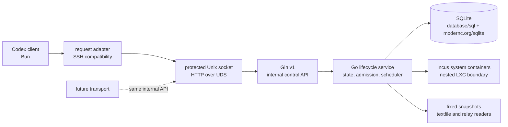

# Agent VM

Agent VM is the source repository for the reusable client, Go control service,
release tooling and operational contracts for low-cost nested Incus system
containers. It is the extracted canonical source for Agent VM work; it does not
depend on `agent-toolkit` at runtime.

The initial standalone snapshot is based on the merged Agent VM implementation
at `2651fc8a8d32eaa611027fc04aa7908843639222` from `agent-toolkit`.

## Architecture



SSH is retained as a compatibility adapter for the current client contract. It
is not the business protocol or the control authority, and it can be removed or
replaced by another transport without changing the Go service or its Gin API.
The managed guest is an Incus system container inside the authorized control
environment. This design does not require KVM or `/dev/kvm`.

## Technology boundary

- Go `1.27.3` owns the resident control service and native lifecycle boundary.
- Gin v1 serves the protected internal HTTP API.
- SQLite is accessed through `database/sql` and `modernc.org/sqlite`; the
  control module uses one writer and separate read connections.
- `x/sys/unix`, `os/exec` and `log/slog` cover Unix process, command and logging
  boundaries.
- Bun remains the local client, compatibility bridge and guest one-shot runtime.
- Python is limited to release/publisher compatibility tools and standard
  library tests.

## Layout

- `skills/agent-vm/` contains the local client and source-sync behavior.
- `skills/agent-vm-ops/` contains the Go control service, compatibility bridge,
  release tools, systemd assets and operations Skill.
- `docs/specs/agent-vm/` contains the public behavior and protocol contracts.
- `docs/adr/` contains the accepted lifecycle, transport, recovery and runtime
  decisions.

## Management console design

The built-in Web management console targets managed images and existing Agent
session VMs, with controlled maintenance and audit. The approved first-release
contract fixes five pages, `zh-CN`/`en` localization, the authenticated
same-origin `/api/v1` boundary, image migration, and package rollback
compatibility.

Read [PRODUCT.md](PRODUCT.md) for product boundaries, [DESIGN.md](DESIGN.md) for the selected workbench baseline, and the [Web surface brief](.impeccable/surfaces/web.md) for task flows. The [management contract](docs/specs/agent-vm/contracts/management-api.md), [OpenAPI document](docs/specs/agent-vm/contracts/management-api.yaml), and its synthetic examples define the shared frontend/backend API and state-compatibility boundary. The [decision memo](docs/proposals/agent-vm-web-console.md) records the source investigation and architecture rationale.

### Web Demo

The repository also ships an independent, static-safe Demo build at the origin
root. It reuses the five management pages and route suffixes but runs only
against an in-memory model. The inspector can switch normal, capacity/data
fault, conflict/unknown-outcome, and empty scenarios; simulated identity,
network, and data settings are shareable as `demo`/`d_*` query parameters.
Demo mutations never call `/api/v1`, never read upload files, and are reset on
refresh. A failed Demo bootstrap stops before rendering the console. This is a
review and documentation surface, not a production-management deployment.

The Inspector UX/UI contract is documented in
[`docs/specs/agent-vm/contracts/web-demo-inspector.md`](docs/specs/agent-vm/contracts/web-demo-inspector.md).
Its interactive controls use the checked-in shadcn/ui baseline declared by
[`web/components.json`](web/components.json) and implemented under
`web/src/components/ui`; normal click, context-menu/long-press, and the
panel-level floating drag-handle behavior are intentionally separate contracts.

Build and preview it with:

```bash
bun run build:demo
bun run preview:demo
```

Deploy the contents of `web/dist-demo` at the origin root. Static hosts must serve
existing assets normally and fall back to `index.html` for page paths such as
`/images` (SPA fallback). For EdgeOne Makers, include an `edgeone.json` in the
uploaded directory with `{"rewrites":[{"source":"/*","destination":"/index.html"}]}`.
The formal build remains `bun run build:web` and
uses the configured real management API boundary.

## Local validation

```bash
bun install --frozen-lockfile
bun run check
bun run test:web
bun run test:e2e
bun run react-doctor:web:staged
bun run test:repo
bun run test:skills
go -C skills/agent-vm-ops/control test -count=1 ./...
go -C skills/agent-vm-ops/control vet ./...
```

Linux native and nested-Incus acceptance requires a session-owned Agent VM and
an explicitly authorized isolated control environment. GitHub Actions runs
portable Bun/Python checks, Go tests, Go vet, Linux cross-builds and Linux race
tests; it does not claim real Incus or systemd acceptance.

Deployment configuration, credentials, host addresses, Incus inventories,
state databases and rendered observability files remain outside this repository.
