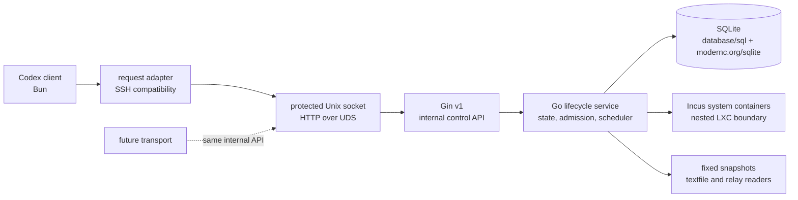

# Agent VM

Agent VM is the source repository for the reusable client, Go control service,
release tooling and operational contracts for low-cost nested Incus system
containers. It is the extracted canonical source for Agent VM work; it does not
depend on `agent-toolkit` at runtime.

The initial standalone snapshot is based on the merged Agent VM implementation
at `2651fc8a8d32eaa611027fc04aa7908843639222` from `agent-toolkit`.

## Architecture



SSH is retained as a compatibility adapter for the current client contract. It
is not the business protocol or the control authority, and it can be removed or
replaced by another transport without changing the Go service or its Gin API.
The managed guest is an Incus system container inside the authorized control
environment. This design does not require KVM or `/dev/kvm`.

## Technology boundary

- Go `1.27.3` owns the resident control service and native lifecycle boundary.
- Gin v1 serves the protected internal HTTP API.
- SQLite is accessed through `database/sql` and `modernc.org/sqlite`; the
  control module uses one writer and separate read connections.
- `x/sys/unix`, `os/exec` and `log/slog` cover Unix process, command and logging
  boundaries.
- Bun remains the local client, compatibility bridge and guest one-shot runtime.
- Python is limited to release/publisher compatibility tools and standard
  library tests.

## Layout

- `skills/agent-vm/` contains the local client and source-sync behavior.
- `skills/agent-vm-ops/` contains the Go control service, compatibility bridge,
  release tools, systemd assets and operations Skill.
- `docs/specs/agent-vm/` contains the public behavior and protocol contracts.
- `docs/adr/` contains the accepted lifecycle, transport, recovery and runtime
  decisions.

## Management console design

The built-in Web management console is a design target and has not been implemented. Its scope covers managed images and existing Agent session VMs, with controlled maintenance and audit.

Read [PRODUCT.md](PRODUCT.md) for confirmed product boundaries, [DESIGN.md](DESIGN.md) for the pre-implementation design seed, and the [Web surface brief](.impeccable/surfaces/web.md) for task flows and the selected workbench layout. The [decision memo](docs/proposals/agent-vm-web-console.md) records the source investigation and architecture rationale. Implementation is pending owner review of these documents.

## Local validation

```bash
bun install --frozen-lockfile
bun run check
bun run test:repo
bun run test:skills
go -C skills/agent-vm-ops/control test -count=1 ./...
go -C skills/agent-vm-ops/control vet ./...
```

Linux native and nested-Incus acceptance requires a session-owned Agent VM and
an explicitly authorized isolated control environment. GitHub Actions runs
portable Bun/Python checks, Go tests, Go vet, Linux cross-builds and Linux race
tests; it does not claim real Incus or systemd acceptance.

Deployment configuration, credentials, host addresses, Incus inventories,
state databases and rendered observability files remain outside this repository.
