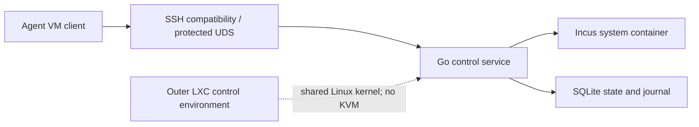

# Native Incus Agent container lifecycle

## Context

The Agent VM product name describes the isolated execution boundary, not the Incus instance type. The control environment may itself run inside an LXC container, and the managed session must remain low-cost inside that boundary. Requiring an Incus VM would add QEMU and hardware-virtualization dependencies, including `/dev/kvm`, without improving the session contract.

## Decision

Each generic session owns at most one Incus system container. Native creation uses `incus init` without `--vm`; the configured image must be a container image, and a VM image is rejected before any lifecycle mutation. The outer control environment may be a nested LXC/Incus container, but the managed session shares the outer Linux kernel and does not require `/dev/kvm`, QEMU, nested hardware virtualization or a guest kernel.

The deployment supplies the container-capable Incus project, profile, image, storage pool, network, idmap/nesting and cgroup capabilities. The controller validates the configured identities and fails closed when the profile or storage cannot enforce the requested rootfs and resource limits. The controller does not mutate host or PVE policy as part of a normal session request.

The public Agent VM product and protocol remain compatible. Existing `protocol=4`, operation identities, lease generations, journal semantics, action names and fields such as `vm_ip` are preserved; `vm_ip` means the managed guest/container address. SSH remains a compatibility transport, while the Go service and protected UDS are the control authority and future HTTP transports reuse the same internal API.

Lease expiry, access cleanup, proxy and conntrack ownership, stopped-cache retention, age-GC, capacity admission and startup reconciliation retain their existing semantics. A stopped cache is a stopped container root filesystem, not a VM disk. Rootfs growth is supported only when the selected Incus storage/profile exposes the required capability; otherwise the request fails closed before mutation or records the existing conservative recovery state.

## Consequences

- Session startup is software-only and works in the intended low-cost nested-LXC deployment without `/dev/kvm`.
- Incus VM images and VM-only quotas are outside the managed container pool and must not satisfy or block container admission.
- Acceptance must exercise a real Incus container image and profile, including startup/IP readiness, proxy mapping, guest tooling, resize where supported, release, cache and cleanup. A successful Incus VM launch is neither required nor evidence for this contract.
- The compatibility names remain public until the supported protocol window ends; documentation must distinguish product names from the underlying Incus instance type.

## Related material

- [Native Incus Agent VM specification](../specs/agent-vm/SPEC.md)
- [Agent VM topology and recovery boundary](0028-agent-vm-topology-recovery-boundary.md)
- [Agent VM topology and recovery runbook](../specs/agent-vm/OPERATIONS.md)
- [Agent VM Go resident control runtime](0037-agent-vm-go-control-runtime.md)
