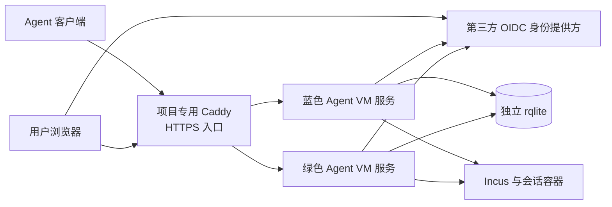

# Agent VM 系统架构

本文是唯一的系统架构文档，描述轻量化目标设计；HTTPS 客户端、OIDC、蓝绿和 rqlite 尚未实现或部署。这里的组件是技术选型，不代表现有机器有可用资源或授权部署。现行行为与部署合同以 [Agent VM Spec](../specs/agent-vm/SPEC.md) 为准；实现时须同步更新相应合同和 ADR。

## 目标和边界

每个蓝绿槽位是**一个 Agent VM 服务**，包含 Web、API、认证、生命周期、调度和 native worker。两个版本可以并行运行，共用独立的 rqlite，切换时不需要结束运行中的容器和有效租约。Caddy 是项目专用 HTTPS 入口；它和 rqlite 是两个槽位共用的独立依赖，不复用其他服务器的部署资源或已有反向代理。

Agent 客户端和浏览器在用户侧；第三方 OIDC 提供方由部署配置指定，允许为单点登录与其通信，不假设某个提供方已经存在。服务器端各组件需与 Incus 控制端在同一受授权主机通信；这只是方案的运行要求，不声称当前环境或权限已满足。

## 架构对象

| 对象 | 技术选择与职责 |
| --- | --- |
| Agent 客户端 | 现有 Bun 客户端增加 HTTPS transport；使用机器 Token 访问控制 API，保留 protocol 4 的操作 ID、generation 和本地 journal。进入容器及源码同步的 SSH 路径与控制 API 传输分别处理。 |
| 用户浏览器 | 使用 Web 页面和 API；普通用户通过第三方 OIDC 登录，管理员与普通用户的权限由服务端区分。 |
| 第三方 OIDC 提供方 | 由实际部署配置的身份服务，负责用户身份认证；Agent VM 不假设已有具体提供方，也不将其当成部署基础设施。 |
| Caddy | 项目专用 Caddy 2.11.7，单独的非 root systemd 服务，在配置的内网 IP 的 `8443` 提供一个 HTTPS 入口；校验 TLS 后将固定路径转发到活动服务，不实现用户身份或资源授权。 |
| 蓝色、绿色 Agent VM 服务 | 同一个 Go/Gin 程序的两个独立 systemd 实例，各自包含 Web 页面与 API、OIDC、机器 Token 校验、生命周期、调度及 native worker 子进程。两个实例使用各自的 Unix socket，服务端代码和资产属于对应版本。 |
| rqlite | 项目专用 rqlite v10.5.2 单节点独立服务，本机回环 HTTP API；启用认证并为蓝绿服务分别配置受保护凭据。它存储用户会话、Token 验证摘要、租约、generation、预留、operation journal 和审计；两个版本共用，不直接打开其 SQLite 文件。 |
| Incus 与会话容器 | Incus 提供系统容器生命周期和网络等原生能力，Agent VM 控制服务通过其受控 native worker 调用；容器是被管理资源。 |
| 活动 slot | 受保护的本机符号链接，指向蓝或绿槽位；它是路由状态，不是额外进程。 |

Caddy、rqlite 和 Incus 是共享依赖，不属于蓝绿产品槽位；这些组件自身故障或升级时可能中断服务，本架构不承诺它们的高可用。蓝绿的承诺针对完整 Agent VM 产品服务，而不是只覆盖其中一个 API。rqlite 单节点也不具备数据库冗余。

## 入口、身份与授权

Caddy 使用本机 CA 为配置的入口 IP 签发 HTTPS 证书，不使用其他服务器的反向代理或公网 CA；禁用公开的 Caddy 管理接口和额外 HTTP 监听，保持一个对外 HTTPS 入口。Agent 客户端及浏览器需要信任此 CA；私钥和状态须受保护及备份。未建立信任时拒绝连接，不关闭证书验证。特定第三方 OIDC 提供方可能不接受 IP 回调；届时需要与提供方兼容、在客户端可解析的稳定名称及相应证书，不能假设默认 IP 必定可用。[Caddy 本机 CA 配置](https://caddyserver.com/docs/caddyfile/options)

入口将 `/agent/v1/control` 转到活动服务的 control handler，Web 页面及 `/api/v1/` 转到同一个活动服务的 Web handler。这些是目标接口，现有客户端与服务需要共同实现；不能将当前本机内部接口直接暴露。Caddy 清除外部伪造的内部身份头，仅向后端转发允许的路径、方法和请求头。Agent 的 Authorization 只发送给 control handler，不记入日志；请求体、响应、协议版本、operation ID 和超时语义保持端到端一致。

普通用户使用第三方 OIDC Authorization Code Flow + PKCE 登录。服务端校验 issuer、audience、签名、有效期、state 和 nonce，以 issuer 与 subject 作为稳定用户身份；使用安全 Cookie、CSRF 和 Origin 检查。OIDC 提供方不可用时新登录失败，不伪造身份。用户和管理员的能力需要单独授权，登录不自动获得管理员权限。

Agent 使用独立的高熵不透明 Bearer Token，而不是浏览器 Cookie；Token 关联机器身份、所有者、权限、过期和撤销状态，服务端仅保存验证摘要。每次操作重新检查身份、权限、会话所有权和 generation。Token 的签发与撤销经受授权的用户操作完成；不把 Token 放入 URL、日志或 operation journal。JWT 不是首期选型。

## 蓝绿切换

每个槽位使用自己的 systemd unit、固定 release 及 `/run/agent-vm-native/blue/app.sock` 或 `/run/agent-vm-native/green/app.sock`。Caddy 的 Web 和 Agent 请求都连接 `/var/lib/agent-vm-native/active/app.sock`；`active` 是 root-owned 符号链接，只能指向上述蓝或绿目录。入口账号可以遍历链接，但不能修改它；不可从外部请求指定目标路径。

受授权的运维过程确认目标完整版本、协议、状态兼容和 readiness 后，在同一文件系统原子替换 `active` 并持久化目录；不依赖既有发布 wrapper，也不新增常驻切换服务。目标无效或健康状态无法确认时不切换；启动时链接缺失或不安全则失败关闭，不猜测另一版本。Caddy 到后端禁用连接复用和写操作自动重放；已建立或正在建立的连接可能仍由旧服务处理，旧槽位须等在途请求和 native worker 收敛后才退出。

浏览器登录、OIDC state、nonce、PKCE 事务、CSRF 状态和 Token 验证记录保存在 rqlite，蓝绿使用兼容的数据格式及共享的受保护密钥；OIDC 回调落入任一版本时只能消费对应事务一次。浏览器会话跨切换可继续使用，不依赖进程内会话表或黏性路由。发布包同时携带按 release identity 区分的静态资源，Caddy 从本机受保护的已验证 release 目录提供这些资源；保留旧版资源至少一小时，新旧 Web API 与状态在同一窗口内兼容。窗口结束后旧页面须得到明确的刷新提示，不能静默加载不匹配资源。资源路径仅允许已验证版本的固定清单，不接受任意本机路径。

## 状态和并发

rqlite 是控制状态的共同权威。每次写操作以 `operation_id`、请求 digest、session 和 generation 识别；原子认领、状态变化和 journal 必须符合既有语义。同一 ID 的不同请求拒绝；响应丢失或提交结果未知时使用原 ID 查询和恢复，不能创建新 ID 重放未知副作用。

现有 Go 代码在 SQLite `BEGIN IMMEDIATE` 内读取、判断并写入，不能直接搬到 rqlite 的 HTTP 请求。必须将各个状态操作改写为 rqlite 支持的单请求事务或条件更新，并证明前置条件失败时没有部分提交；权属和租约读取选择 linearizable 一致性。禁止对关键状态使用 queued writes。 [rqlite 事务 API](https://rqlite.io/docs/api/api)、[读一致性](https://rqlite.io/docs/api/read-consistency)

两个槽位的 scheduler 可以同时运行，但任务清理和其他操作须经过相同的数据库认领与本机跨进程锁；同一会话串行，共享容量准入有全局锁和状态复核，不同且不冲突的会话可以并行。native worker 是所属服务启动的一次性子进程，不是独立部署的常驻执行器。蓝绿必须使用同一套锁路径、锁顺序和 journal 合同。

数据库事务与本机锁不能证明 Incus 异步操作已经停止。服务记录 worker 的 slot、PID、启动身份、进程组与已知 Incus operation identity；重启或跨版本恢复时先核查旧 worker 和 Incus 操作，再依据 journal 和实际资源状态继续。锁释放、租约超时或服务退出本身不允许重放；无法确认时保留未知状态，并阻止受影响资源的冲突操作。

## 权限与故障

每个 Agent VM 服务作为 root 运行，以使用现有 Incus 权限；Caddy 作为独立的非 root UID 运行，服务的 Unix socket 只接受该 UID。Web 路由、OIDC 回调和用户输入因此也会由高权限服务处理，必须限制请求大小、方法、路径和输入，验证身份与资源授权，并通过 systemd 对文件系统、执行权限和网络进行与 Incus 兼容的最小化约束。此设计接受高权限 Web 请求处理这一取舍，不能声称与现有非 root Web 进程拥有相同隔离性；[ADR 0042](../adr/0042-agent-vm-web-management-boundary.md) 的边界须在实施前更新。

| 故障 | 行为 |
| --- | --- |
| 某槽位不健康 | 不把新请求切到该槽位；活动槽位失败时返回可识别错误，不盲目切换或重放。 |
| Caddy 不可用 | 新请求不可用；已执行的操作结果依 journal 恢复，不能假定已取消。 |
| rqlite 不可用或权属不确定 | 拒绝依赖持久状态的写入、准入和清理，不主动终止已有有效容器；恢复后先核对状态。 |
| Incus 或 native worker 结果不明 | 保留 journal 和资源预留，阻止受影响资源的冲突操作，核实后恢复。 |
| OIDC 提供方不可用 | 新的浏览器登录不可用；已有会话按其有效期和撤销状态处理，Agent Token 不依赖浏览器登录路径。 |

## 架构验证条件

- 验证所有现有状态事务能够以 rqlite 单请求事务或条件更新安全表达，包括失败、冲突、重复请求和提交结果未知；保留 generation、`state_epoch` 与 journal 排序语义。
- 在隔离 Agent VM 中验证蓝绿并发 acquire、renew、release、resize、端口、调度和容量准入，以及 worker、systemd 进程组与 Incus 异步操作的故障恢复。
- 验证 HTTPS 证书与 peer 身份、OIDC 回调及浏览器会话跨版本切换、Token 授权和撤销、旧版静态资源、原子切流与在途请求不重放。
- 验证新旧版本的 API、资产与持久状态兼容；不兼容时拒绝回退，不恢复旧数据库覆盖当前状态。
- 测量单节点 rqlite、Caddy 和两套服务在目标负载下的资源使用；以上是架构验收条件，不是已取得的运行证据。
