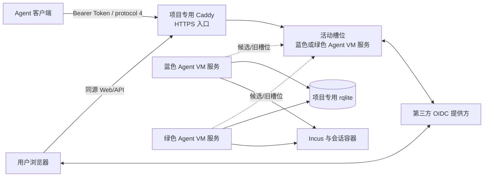

# Agent VM 系统架构

本文是 Agent VM 唯一的系统架构文档，描述蓝绿服务、身份边界、共享状态和故障恢复的目标合同。HTTPS 客户端、OIDC、蓝绿切换和 rqlite 迁移尚未由本仓库当前实现或部署；本文件不构成现网资源、地址、凭据或权限已经存在的证明。现行长期行为以 [Agent VM Spec](../specs/agent-vm/SPEC.md)、[管理 API 合同](../specs/agent-vm/contracts/management-api.md)、[Token API 合同](../specs/agent-vm/contracts/token-api.md) 和 [Agent API 合同](../specs/agent-vm/contracts/agent-api.md) 为准，关键取舍见 [统一服务安全边界 ADR](../adr/0043-agent-vm-unified-service-security-boundary.md) 与 [状态迁移 ADR](../adr/0044-agent-vm-state-migration-to-rqlite.md)。

## 目标和边界

每个蓝绿槽位是一个完整的 Agent VM 服务，包含静态 Web、浏览器 API、OIDC 回调、Token 校验、生命周期、调度和 native worker。两个槽位可以并行运行，共用项目专用的 rqlite 状态服务；切换时不结束运行中的容器和有效租约。Caddy 是项目专用的稳定 HTTPS 入口；它和 rqlite 是槽位共用的独立依赖，不复用其他服务器的部署资源或已有反向代理。

本架构不引入独立路由器、常驻 Web/BFF、native service 或发布 wrapper。每个槽位只有一个 Go/Gin 服务进程作为业务与状态权威；Caddy 只负责 TLS 终止、固定路径转发和活动槽位选择。服务以现有 Incus 权限运行，因此浏览器处理进入高权限服务是明确接受的安全取舍，必须由固定路由、输入边界、身份授权、审计和 systemd 限制共同缓解。

Agent 客户端和浏览器在用户侧；第三方 OIDC 提供方由部署配置指定，允许服务与其通信，不假设某个提供方已经存在。服务器端服务需要与 Incus 控制端在同一受授权主机通信；这是方案的运行要求，不声称当前环境或权限已经满足。

## 架构对象

| 对象 | 技术选择与职责 |
| --- | --- |
| Agent 客户端 | 现有 Bun 客户端逐步增加 HTTPS transport；使用高熵不透明机器 Token 调用 Agent API，保留 protocol 4 的操作 ID、generation 和本地 journal。进入容器及源码同步的 SSH 路径与控制 API 传输分别处理。 |
| 用户浏览器 | 通过 Authorization Code + PKCE 登录第三方 OIDC；使用安全浏览器会话访问 `/api/v1`。普通用户只能访问本人会话和本人 Token，管理员能力由服务端的精确身份映射授予。 |
| 第三方 OIDC 提供方 | 负责用户认证和 ID Token；服务端校验 discovery issuer、授权码响应、签名、audience、有效期、state 和 nonce，不把邮箱、显示名或 group claim 当作稳定身份。 |
| Caddy | 项目专用 Caddy 2.11.7，独立的非 root systemd 服务，在配置的稳定 HTTPS 入口提供一个外部入口；只做 TLS、固定路径转发和活动槽位选择，不实现用户身份或资源授权，不注入身份头。 |
| 蓝色、绿色 Agent VM 服务 | 同一个 Go/Gin 程序的两个独立 systemd 实例，各自包含 Web、`/api/v1`、OIDC、Token 校验、`/agent/v1/control`、生命周期、调度和 native worker。每个实例使用自己的 Unix socket，代码、静态资源和发布身份属于对应版本。 |
| rqlite | 项目专用 rqlite v10.5.2 单节点服务，本机回环 API，启用认证并使用受保护凭据。它是迁移完成后的共享状态权威，保存浏览器会话、OIDC 事务、Token 验证摘要、角色映射、租约、generation、预留、operation journal、状态能力和审计；服务不直接打开 rqlite 底层 SQLite 文件。 |
| Incus 与会话容器 | Incus 提供系统容器生命周期和网络等原生能力；Agent VM 服务通过受控 native worker 调用，容器是被管理资源。 |
| 活动槽位 | 受保护的本机 `active` 路由状态，指向蓝色或绿色槽位；它不是额外进程，也不是新的业务权威。 |

Caddy、rqlite 和 Incus 是共享依赖，不属于蓝绿产品槽位；这些组件自身故障或升级时可能中断服务，本架构不承诺它们的高可用。蓝绿承诺针对完整 Agent VM 服务，不是只覆盖其中一个 API。单节点 rqlite 也不具备数据库冗余。

## 入口、身份与授权

Caddy 使用项目配置的证书和稳定入口提供 HTTPS，禁用公开管理接口和额外 HTTP 监听。客户端和浏览器必须验证证书；不得通过关闭校验、信任任意证书或接受未经配置的入口来绕过 TLS。特定 OIDC 提供方若不接受 IP 回调，部署必须提供与其兼容、由客户端可解析且证书覆盖的稳定名称；不能假设默认 IP 必定可用。

Caddy 只将下列固定路径转发到活动槽位，并清除不在允许集合内的请求头：

| 路径 | 合同 | 身份方式 |
| --- | --- | --- |
| `/api/v1/auth/oidc/start`、`/api/v1/auth/oidc/callback` | 浏览器登录启动与一次性回调 | OIDC Authorization Code + PKCE；回调不接受 Bearer Token |
| `/api/v1/` | 同源管理、会话和 Token API | 活动服务签发的安全 Cookie，写操作另需 CSRF 和精确 Origin |
| `/agent/v1/control` | Agent API | `Authorization: Bearer <opaque-token>`；不接受浏览器 Cookie |
| 静态资源和健康检查 | 活动发布包的固定清单 | 不承载资源授权；不得暴露任意本机路径或调试路由 |

OIDC 登录使用 Authorization Code Flow + PKCE。服务端为每次登录生成一次性 `state`、`nonce` 和 code verifier 事务，并把回调 URI、目标客户端、过期时间和消费状态绑定到事务；跨槽位时事务存于共享状态，code verifier 受保护存储。回调必须精确匹配未过期且未消费的 `state`，校验授权码交换的 TLS、redirect URI、ID Token 签名和 discovery issuer，且检查 `iss` 精确等于配置的 issuer、`aud` 包含本客户端 ID、`exp` 有效以及 `nonce` 与事务一致。OIDC 提供方不可用、验证失败或事务重复消费时登录失败，不伪造身份。

服务把稳定用户身份表示为大小写敏感的 `(issuer, subject)` 二元组。`issuer` 必须是经过配置和 discovery 校验的完整标识；`subject` 使用 OIDC `sub`，不使用邮箱、名称、group 或未经验证的代理头。角色和能力映射按完整二元组解析并持久化；登录不自动获得管理员权限。历史数据无法根据该二元组确定归属时，普通用户不能领取资源，必须由管理员对明确的旧记录和新 `(issuer, subject)` 做一次有原因、有确认、有审计的显式映射；不能用相似邮箱或“第一个登录者”猜测归属。

浏览器会话使用不可预测的 opaque cookie，带 `Secure`、`HttpOnly`、`SameSite=Strict`、`Path=/` 和有限 TTL；会话摘要、issuer/subject、能力、创建时间、过期时间和撤销状态存入共享状态。`GET /api/v1/session` 返回当前二元组、角色、能力和一次会话绑定的 CSRF token。每个写请求必须带同一会话、CSRF token 和与稳定 HTTPS 入口完全相等的 `Origin`；CORS 关闭。浏览器会话不是 Agent Token，也不能调用 Agent API。

普通用户的授权检查必须同时满足：会话的 `(issuer, subject)`、Token 所有者和请求的 `session_id` 三者相符，且 Token scope 覆盖操作。普通用户只能读取、创建、轮换或撤销自己的 Token，只能看到自己的会话和 Token 元数据，不能通过猜测 ID、筛选条件或管理页面读取别人的资源。管理员能力来自精确的角色映射，并且仍受每个操作的 scope、ownership、generation 和 state version 检查。

管理员对有效租约、镜像默认值、镜像退役/删除、维护和历史归属的干预必须先返回影响预览，再提交绑定到当前主体、准确目标、参数、resource version 和 generation 的一次性 confirmation token。提交请求必须带非空且有界的原因；服务端再次检查授权和状态，失败不产生 native effect。接受、拒绝、成功、失败和结果未知都写入审计，审计保存 `(issuer, subject)`、角色、原因、operation ID、目标、阶段、结果和安全错误码，不保存 Token 明文、OIDC code、原始命令输出、凭据或私有路径。

## Token API 与 Agent API

Token API 和管理 API 共用同源 `/api/v1`，具体字段见 [Token API 合同](../specs/agent-vm/contracts/token-api.md) 及其 OpenAPI 路径。Token 是高熵、不可预测的不透明 Bearer 值；服务端只保存带版本的验证摘要和必要元数据。明文只在创建响应中返回一次，随后不可恢复。Token 不出现在 URL、日志、审计 reason、operation journal、静态资源或浏览器 Cookie 中；撤销、过期和 scope 检查对每个请求重新执行。

Agent API 是 `POST /agent/v1/control`。它接收原有 protocol-4 JSON body，不新增第二套生命周期协议。服务端先验证 Token，再验证 issuer/subject、scope、session 所有权、generation、operation ID 和 request digest；session-scoped action 不能通过 Token 改写成另一个主体。无 session 的只读观测只对显式的管理员观测能力开放。Agent API 返回原有成功、错误、未知结果和 journal 语义；网络超时不等于 native effect 未发生，也不允许用新 operation ID 重放。

## 蓝绿切换和兼容窗口

每个槽位使用自己的 systemd unit、固定 release 和 `/run/agent-vm-native/blue/app.sock` 或 `/run/agent-vm-native/green/app.sock`。Caddy 的所有固定路径都连接 `/var/lib/agent-vm-native/active/app.sock`；`active` 是受保护的符号链接，只能指向蓝或绿的已验证目录。外部请求不能选择槽位、socket 或本机路径。

受授权的发布过程必须验证目标 release、API/状态能力、OIDC 配置兼容性、静态资源清单、服务 readiness 和 rqlite 状态，然后在同一文件系统原子替换 `active` 并持久化选择。不依赖独立路由器、发布 wrapper 或黏性会话。Caddy 不自动重放写请求；已经建立或正在建立的连接可能由旧服务完成，旧槽位在途请求和 native worker 收敛前不得退出。

新旧槽位共享会话、OIDC state/nonce/PKCE 事务、Token 摘要和状态能力。OIDC 回调落入任一槽位时只能消费对应事务一次；浏览器会话跨切换继续有效，不依赖进程内会话表。旧版静态资源和 API 至少保留一个小时的兼容窗口；release manifest 必须声明 protocol、请求/响应/语义窗口和状态 capability 的读写集合。窗口内两个槽位只接受双方都能安全处理的合同；窗口结束后旧页面得到明确刷新提示，不能静默使用不匹配资源。回滚必须通过同一状态能力检查，不能让旧版本覆盖或降级共享状态。

## 状态、迁移和原子并发

现有 SQLite 是迁移前的单一权威，保留 schema、protocol 4、generation、`state_epoch`、operation journal 和 unknown-outcome 语义。迁移到 rqlite 采用保守的一次性切换：先 drain 并阻止新的 native admission，生成一致的 SQLite 备份和导出，验证 schema/capability/行数/摘要，再以 rqlite 的事务请求导入；验证失败时保持 SQLite 未修改并恢复旧服务，不做双写、实时双主或反向猜测同步。

rqlite 成为权威后，所有跨行状态变化使用 `POST /db/execute?transaction` 的单请求事务，不能在 SQL 中自行发送 `BEGIN`、`COMMIT`、`ROLLBACK` 或把多条关键写入拆成独立 HTTP 请求。关键授权、ownership、lease、generation、operation journal、Token 撤销和状态能力读取使用 linearizable consistency；只读观测只有在明确可接受新鲜度时才能使用较弱一致性，并保留 freshness。服务不直接读取 rqlite 节点的 SQLite 文件。

每个写操作以 `(operation_id, request_digest, issuer, subject, session_id, generation)` 识别。同一 operation ID 的相同请求在事务中幂等，冲突请求拒绝。需要同时更新资源、引用、resource version 和 journal 的路径必须在一个事务内完成，使用条件更新/唯一约束确保 compare-and-act 原子性；不得以“先读取再独立更新”替代。蓝绿服务使用同一套本机锁路径和锁顺序：同一 session 串行，共享容量准入使用全局锁和状态复核，不冲突的 session 才能并行。

数据库事务和本机锁不能证明 Incus 异步操作已经停止。服务记录槽位、PID、启动身份、进程组和已知 Incus operation identity；native effect 在事务外执行时保留 pending journal，并在完成后用 generation/resource version 条件提交结果。锁释放、租约超时或服务退出不允许自动重放；结果不明时保留预留和审计，阻止受影响资源的冲突操作，核实后再恢复。

## 权限与故障

每个 Agent VM 服务作为 root 运行以使用现有 Incus 权限；Caddy 作为独立非 root UID 运行，仅能连接已验证的活动 socket。统一服务边界接受浏览器请求和 native control 在同一高权限进程中的风险，因此必须限制请求大小、方法、路径和静态资源清单，禁止任意命令/文件/内部转发路由，严格执行 OIDC、Cookie、CSRF、Origin、Token、scope、ownership、generation 和 reason 校验，使用结构化脱敏日志，并通过 systemd 限制文件系统、执行权限和网络。该边界替代 [ADR 0042](../adr/0042-agent-vm-web-management-boundary.md)，现行选择见 [ADR 0043](../adr/0043-agent-vm-unified-service-security-boundary.md)。

| 故障 | 行为 |
| --- | --- |
| 某槽位不健康 | 不把新请求切到该槽位；活动槽位失败时返回可识别错误，不盲目切换或重放。 |
| Caddy 不可用 | 新请求不可用；已执行的操作结果按 journal 恢复，不能假定已取消。 |
| rqlite 不可用或一致性无法证明 | 拒绝依赖持久状态的登录、Token、写入、准入和清理，不主动终止已有有效容器；恢复后先核对状态。 |
| OIDC 提供方不可用 | 新浏览器登录失败；已有未过期且未撤销的会话按本地状态处理，Agent Token 不依赖浏览器登录路径。 |
| Incus 或 native worker 结果不明 | 保留 journal、预留和资源绑定，阻止受影响资源的冲突操作，核实后恢复。 |
| 新旧 release 状态能力不兼容 | 不切换或不回滚；保持当前已验证槽位和 drain 状态，不能重建或降级数据库。 |

## 架构验证条件

- 验证 OIDC Authorization Code + PKCE 的 issuer/subject、state、nonce、签名、audience、过期和一次性回调消费；验证蓝绿切换后浏览器会话和 Token 摘要仍可用。
- 验证普通用户只能访问本人 session/Token，管理员敏感操作需要权限、原因、预览确认和完整审计；验证 Token 撤销、过期、scope 缩减和未知主体拒绝。
- 在隔离 Agent VM 中验证 `/agent/v1/control` 与 SSH 兼容路径的 protocol-4 请求、generation、operation journal、超时恢复和重复请求；验证 Caddy 不接受任意路由或身份头。
- 验证 SQLite 导出到 rqlite 的 schema/capability/行数/摘要一致性、单次事务导入、失败回退、无双写和关键读取的一致性选择；验证 rqlite 不可用时安全停写。
- 验证蓝绿并发 acquire、renew、release、resize、端口、调度和容量准入，保证同一 session 串行、跨槽位原子 compare-and-act、native unknown 不重放。
- 验证至少一小时的静态资源/API/状态兼容窗口、原子切流、在途请求收敛和不兼容回滚拒绝；以上是架构验收条件，不是已取得的运行证据。
