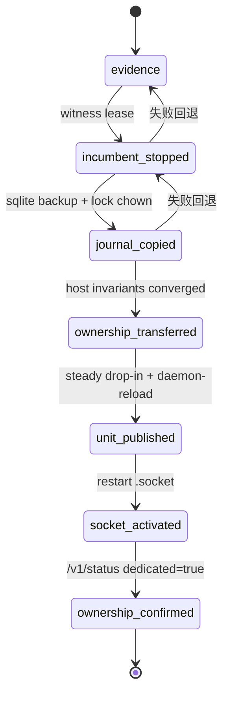

# 既有安装的升级与部署健壮性

## 状态

本文是升级与部署健壮性的问题诊断与方案收敛记录，当前只定义证据、根因、设计目标和实施顺序，不修改安装器、部署事务或质量合同，也不代表方案已经实施。已接受的部署面约束以 [ADR 0057](adr/0057-agent-vm-state-markers-are-informational.md) 为准，本文不重新引入该 ADR 拆掉的准入条件。

## 已确认的问题

2026-11-26 对 105 的正式升级（1.6.0 起家的既有安装，中途停在 1.9.5）连续遇到八次阻塞，业务中断约五十分钟。八次阻塞不是八个独立缺陷，而是同一条安装器路径上四类结构性缺陷的反复表现。

事实记录如下，均来自该宿主的一次性操作，不包含地址、凭据或库存。

| 顺序 | 阻塞 | 直接原因 |
| --- | --- | --- |
| 1 | `existing installation file differs: /opt/agent-vm-native/maintenance/agent-vm-deploy` | 迁移用 `installFile` 复制维护二进制，而该函数从不覆盖已存在路径 |
| 2 | `copy deployment journal: deployment singleton lock is not a protected root-owned file` | 交接前把 `/run` 前缀的 tmpfiles 规则应用到已运行的锁上，改掉了 root 所有权 |
| 3 | `unauthenticated peer`（`fork/exec /proc/self/fd/3: operation not permitted`） | `agent-vm-request@.service` 的 `NoNewPrivileges=yes` 与 relay 的 setuid 降权互斥 |
| 4 | `stage_rejected: open <private-path>: permission denied` | `migration/bridge-1.9.5` 等旧目录仍属 root，部署账户无法进入 |
| 5 | `deployment host action failed` | helper socket 单元文件被重写后未重启，systemd 已丢弃监听描述符 |
| 6 | `untrusted deployment unit directory` | 为放行写操作把 `.service.d` 改成组可写，触发 root 保护断言 |
| 7 | `managed routing path missing` | `routing/active` 受管链接在历史迁移中丢失，只剩未受管的直连链接 |
| 8 | `rollback previous version failed to start after three attempts` | 回退目标槽的旧 release 读不了当前数据库（`vm-hold@1`），回退在物理上不可能 |

第 4 项暴露了最关键的诊断缺陷：拒绝响应只给出脱敏后的 `<private-path>`，运维者无法据此定位。最终定位靠临时构建一个不脱敏的诊断二进制，装上宿主后一次命中。此前六轮均为排除法猜测。

## 根因归类

### A. 预检枚举的是已知前提，不是本次事务会触碰的路径

`Preflight` 校验配置、凭据、材料完整性、systemd 与 Incus 可用性，全部通过。但第 4、5、6、7 项所需的前置条件（旧目录属主、helper socket 是否真的在监听、受管路由是否存在、槽位 unit 里的二进制名）不在其中。它们第一次被触碰是在 `stage` 内部，此时任何失败都会 fence 两个槽位。

结果是「预检通过」不构成「可以开始」的证据，而失败代价被放大成业务中断。

### B. 失败不留可诊断证据

事务创建之前的拒绝不落库。带事务的拒绝虽然按合同携带 `reason`，但路径被脱敏，且不留存调用时的 `uid`、`gid` 与真实路径。运维者能看到的只有公开错误码和一条被抹掉关键信息的字符串。

安全要求（日志不得泄露路径）与可诊断要求（运维者必须知道哪个路径被拒）被混为一谈，代价是每一轮排查都要靠猜测。

### C. 同一批宿主对象的不变量分散在十五处，且互相矛盾

全仓库有十五处各自的 `Uid`/`mode` 断言（`rootProtected`、`checkHostUnitDirectory`、`untrusted slot configuration`、`release input must be protected against writes by other users`、`unexpected ownership, permissions or file type` 等）。同一目录要同时满足「部署账户可写」和「他人不可写」，而这两条在不同断言里被写成了不同形式。

第 6 项就是这个矛盾的产物：`0750` 让部署账户读不到，`0770` 触发「他人可写」拒绝，`root:agent-vm-deploy 0750` 又回到读不到。没有一个模式能同时满足两处断言，因为两处断言的语义本身不一致。

### D. 交接是一串无状态命令，不是可恢复状态机

账户交接按序执行：写证据、停旧进程、复制日志库、转移恢复材料、发布 unit、启动新进程、确认所有权。任一步失败时，已经生效的部分不会回退。

105 上实际观察到的半应用状态同时包含四种：恢复材料目录已转给部署账户、`/run` 单例锁仍属 root、受管路由链接已丢失、日志库尚未复制。这种状态既不是旧形态也不是新形态，后续任何动作都必须先考古。

### E. 回退可行性未在动作前判断

第 8 项：回退目标槽的旧 release 读不了当前数据库，回退必然失败，但系统仍尝试三次才放弃，每次失败都 fence 一次。ADR 0057 已裁定部署面不据此拒绝动作，但「不拒绝」不等于「不提前告知」。运维者在按下 `update` 时无法知道这条路没有回头路。

### F. 恢复材料的断言与预算覆盖了无关残骸

`transferRecoveryOwnership` 对 `RecoveryDirectory` 整树断言「无 group/other 位、属主为 root 或部署账户」，`recoveryMaterialBytes` 把整树字节计入 `used`。这两处都没有区分「当前权威正在使用的恢复材料」与「历史迁移留下的残骸」。

105 实测：

```text
migration/ 总计 139 MB
  rqlite-recovery/（真正被恢复点使用）    14.7 MB
  历史残骸（bridge-1.9.5、quarantine-*、pre-*）  124.6 MB
```

后果有两层。其一，第 4 项那个 `bridge-1.9.5` 目录本身合规（`root:root 0700`），但它不属于本次交接范围，却被强制要求转给部署账户。其二，`CreateRecoveryPoint` 的空间判定是 `min(1 GiB - used, free) - reserve`，`used` 含 124 MB 残骸，直接压缩可用预算。这解释了 105 上早期出现的 `backup_storage_exhausted`。

断言本身正确（恢复材料必须私密），错在**作用域**。

### G. 可预检的失败被映射成需要人工恢复

`failure()` 的判定是 `if phase == PhaseRollback || errors.Is(cause, ErrUncertain) { code = "state_unverified" }`，而 `state_unverified` 会写 `recovery_required = true`。于是 rollback 阶段**任何**失败——包括回退目标根本读不了数据库这种确定性失败——都变成 `needs_recovery`，进而阻塞所有后续部署，直到人工执行恢复动作。

`ListActive` 已经排除了 `failed`，`status` 也只返回活跃事务。所以问题不在「终态失败被当成阻断」，而在**本可为 `failed` 的确定性失败被升级成了 `needs_recovery`**。105 的 rollback 三次启动失败正是如此：没有任何不确定副作用，但事务停在 `needs_recovery`。

### 关于能力标记的澄清

本文不提议恢复任何以能力标记为依据的准入。ADR 0057 的裁决保持不变：部署面不解析、不比较、不据此拒绝动作，降级后果由运维者承担。第 8 项的旧 release 拒绝启动发生在**旧二进制内部**（`internal/lifecycle`），部署面拦不住也不该拦。可做且应做的只有观测与提示。

## 设计目标

1. 既有安装（历史 unit 命名、未受管路由、root 属旧目录）能在零人工干预下完成一次完整升级。
2. 任何拒绝都必须能在一条命令内给出真实路径与当时的身份，不需要构建诊断二进制。
3. 同一宿主对象只能有一份不变量定义，且该定义同时驱动检查与收敛。
4. 交接中断后可从断点续跑，不产生既非旧也非新的中间态。
5. fence 只用于「原生副作用已发生但结果不明」，不用于可预检的前置条件。
6. 回退不可能时，在动作前告知，不阻断动作。

## 方案

### W1 宿主不变量表：单一权威，同时驱动检查与收敛

把十五处断言收敛成一张声明式描述表，每个宿主对象一行。

```go
type Kind int // Dir | File | Symlink | Unit | Socket

type HostObject struct {
    Path     string
    Kind     Kind
    Owner    string      // "root" | "agent-vm-deploy" | "agent-vm-server"
    Group    string
    Mode     os.FileMode
    Writable bool        // 部署账户是否需要写
    Traverse bool        // 其他账户是否需要遍历读取
    Required bool        // 缺失是否阻塞
    Legacy   Migration   // 历史形态的收敛动作
}
```

三类消费者读同一份数据。

| 消费者 | 行为 | 入口 |
| --- | --- | --- |
| 只读报告 | 逐条输出 `path / 期望 / 实际 / 是否阻塞 / 建议动作` | `agent-vm-deploy doctor` |
| 预检 | `Required && 不符` 变成结构化 blocker，在事务前 | `Preflight` 增补 |
| 收敛 | 幂等应用，逐条落 evidence | `--apply` 前后的 `converge` 阶段 |

表内需要覆盖 105 上实际手工修正过的对象，共十一项：

```text
/var/lib/agent-vm-native/migration                dir   agent-vm-deploy  0700  writable
/var/lib/agent-vm-native/migration/rqlite-recovery dir  agent-vm-deploy  0700  writable
/var/lib/agent-vm-native/slots                    dir   agent-vm-deploy  0750  traverse
/var/lib/agent-vm-native/slots/<slot>             dir   agent-vm-deploy  0750  writable
/var/lib/agent-vm-native/release-staging          dir   agent-vm-deploy  0700  writable
/var/lib/agent-vm-native/routing                  dir   agent-vm-deploy  2750  writable
/var/lib/agent-vm-native/routing/active           link  ← slots/<slot>  required
/var/lib/agent-vm-native/active                   link  ← routing/active  installer-owned
/var/lib/agent-vm-native/deployment/runtime        dir  agent-vm-deploy  0700  writable
/var/lib/agent-vm-native/deployment/runtime/deployment.sqlite3  file  agent-vm-deploy  0600
/run/agent-vm-native/deployd.lock                 file  agent-vm-deploy  0600
/etc/systemd/system/agent-vm-native@.service      unit  root:root 0644  exec 按版本选择
/etc/systemd/system/agent-vm-native@<slot>.service.d  dir  root:root 0755  traverse
```

「他人不可写」由 `Writable` 与 `Traverse` 两个布尔量表达，不再由各断言自行推导 `mode & 0o022`。这直接消掉第 6 项那类矛盾。

收敛动作必须幂等：已符合则跳过并落 `unchanged`，不符合则改并落 `before → after`。

### W2 失败即留证

两层拆分，安全与可诊断不再互斥。

- 公开 API 继续脱敏，保持现有合同。
- root 独占详情：`/var/lib/agent-vm-native/deployment/attempts/<attempt-id>.json`，`0600`，记录未脱敏的真实路径、syscall 错误、当时的 `uid`/`gid`/补充组、以及触发它的阶段与事务。
- `agent-vm-deploy explain <attempt-id>` 与 `explain --last` 打印该详情。
- `status` 附带最近一次拒绝的摘要、脱敏原因，以及一句 `next: agent-vm-deploy explain --last`。

事务创建**之前**的拒绝也写一条 attempt 记录。诊断信息与安全边界分离后，第 4 项不需要任何临时的不脱敏构建。

### W3 交接改为可恢复状态机

把当前的无状态命令序列改写成显式 phase，状态落库，每步自带校验。



约束：

1. 每个 phase 的入口条件用 W1 的表判断，不内联新的断言。
2. 中断后以同一 transaction ID 从最后一个已完成 phase 续跑。
3. 续跑前重新观测，不假设磁盘状态等于记录的状态。
4. 回退只在副作用可逆的 phase 间允许；不可逆边界（日志库复制完成）之后只能前进。

### W4 兼容性只观测不阻断

严格遵循 ADR 0057。

1. `status` 与 `doctor` 输出每个槽位的 `reads` 与数据库标记的差集，纯信息。
2. `update` 与 `install` 在预检报告里增加一行：`rollback_target=green(1.9.5) cannot read vm-hold@1; rollback will fail`。只提示，不阻断，不进入 `blockers`。
3. 需要真正阻止旧代码运行时，由服务内部以读写失败暴露，部署面不预判。

### W5 多跳升级作为物理约束，不是能力判断

`1.6.0 → 1.12.x` 必须经 `1.9.5`，理由是 `task_holds` 的 schema 对旧二进制不可解析——旧 release 的 SQL 会直接报错。这是 ADR 0057 认可的边界：在服务内部以读写失败暴露，部署面只需在预检阶段把已知的物理不兼容告知运维者。

实现方式是契约数据（一张版本区间表），不是运行时能力比对：命中不允许的跨度时，预检报告给出 `next: 1.6.0 → 1.9.5 → 1.12.x`，并说明依据是 schema 而非标记。

### W6 fence 纪律收紧

当前任何 `stage` 失败都会 fence 两个槽位，第 4 至第 7 项因此各自造成一次中断。

调整后的判定：

- 可预检的前置条件必须在 fence 点之前判完（W1 表 + W2 记录）。这类失败**不 fence**，事务以 `failed` 结束，现役槽继续服务。
- fence 只保留给「原生副作用已发生但结果不明」：已停进程、已改链接、已写角色。
- `failed`（无副作用）与 `needs_recovery`（副作用不明）的区分必须显式，不能都用 fence。

## 验收方式

新增 `legacy` fixture，复刻 1.6.0 起家的宿主形态，作为回归基线：

```text
- active -> slots/blue（未受管直连）
- routing/ 目录存在但无 active 链接
- /etc/systemd/system/agent-vm-native@.service 的 ExecStart 与 ConditionPathExists 指向 agent-vm-control
- /var/lib/agent-vm-native/migration 全树属 root 0700，含历史 bridge 与 quarantine 目录
- deployd 以 root 运行，helper socket 单元不存在
- 数据库含 task_holds 表
```

必过用例：

| 用例 | 断言 |
| --- | --- |
| 全新安装 | 一次通过，`doctor` 全绿 |
| `legacy` → 1.9.5 | 账户交接完成，`dedicated=true`，零人工命令 |
| `legacy` → 1.12.x（跳过 1.9.5） | 预检给出多跳路径与物理原因，不进入 stage |
| 直接 1.12.x → 下一版 | `update` 成功，`maintenance_binary=current` |
| 交接中断续跑 | 在 `journal_copied` 后强杀 deployd，重跑从该点续，不产生中间态 |
| 预检期失败 | 现役槽继续接流，`status` 可读，无 fence |
| 不兼容回退 | 预检输出 `rollback will fail`，`update` 仍可执行 |
| 诊断闭环 | 任意拒绝都能用 `explain --last` 得到真实路径，无需临时构建 |

每条用例都必须在隔离 VM 中执行，并以宿主实测证据而非静态推理结论记录；静态检查、单元测试与完整实证必须分别标注。

## 实施顺序

| 优先级 | 内容 | 消除 | 验收 |
| --- | --- | --- | --- |
| P0 | W1 不变量表 + `doctor` + converge 接入 apply | A、C | `legacy` fixture 零人工完成升级 |
| P0 | W2 attempt 记录 + `explain` | B | 任意拒绝一条命令给出真实路径 |
| P1 | W3 交接状态机 + 断点续跑 | D | 强杀后重跑可续 |
| P1 | W6 fence 纪律 | A 的后果 | 预检期失败不中断业务 |
| P2 | W4 兼容性观测 + W5 多跳契约 | E | 预检给出回退与跨度提示 |
| P2 | 收敛的 `--dry-run` | — | 输出与 apply 一致的 action 列表 |

P0 两项是其余各项的地基：不变量表提供检查与收敛的共同语义，attempt 记录提供可验证的证据链。二者合起来即可让 `legacy` fixture 的首次升级一次通过，这是本方案的核心承诺。

## 影响与风险

1. 不变量表会改变现有十五处断言的报错文本。结构化错误码保持不变，但依赖具体文案的外部脚本需要检查。
2. converge 阶段需要写 `/etc/systemd/system` 与 `routing`，部署账户的写路径因此扩展。写入对象仍受 root 保护断言约束，且每次变更落 evidence。
3. 交接状态机引入新的持久状态（phase 记录）。旧 transaction 没有该字段时按「未开始交接」处理，不做推断。
4. `doctor` 与 `explain` 是新增只读入口，不改变现有命令语义。
5. fence 收紧会改变失败语义。若某处实际存在未识别的副作用，收紧会导致「报告 failed 但槽位状态已变」。因此 W6 必须在 W1 与 W2 完成后才实施，且每条 fence 点都要补充「该点之前哪些动作已不可逆」的说明。

## 不在本方案范围

1. 恢复点预算、租约区间、保留策略——分别由 ADR 0058 与 ADR 0056 维持。
2. 状态标记的语义与准入——由 ADR 0057 维持，本方案不修改。
3. 控制面拓扑与宿主机维护路径。
4. 客户端协议版本与发布流程本身。
