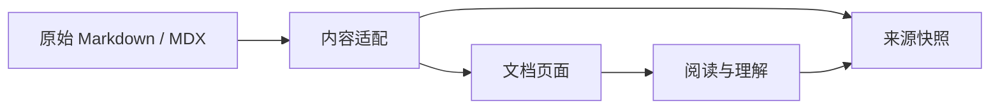

# Agent VM 文档站工程方案

## 范围

独立文档站直接展示项目文档，最小集展示已有项目概览、CLI、系统架构与文档站主题。不建设审阅工作台、需求追溯页或管理台嵌入。

## 技术组合

采用 Fumadocs Radix UI、Fumadocs MDX、React、TypeScript、Vite 和 React Router。Bun workspace `docs-site/` 共用根锁文件；React Router 关闭运行时 SSR，枚举页面预渲染，交付静态资源。具体锁定版本见 `docs-site/package.json` 与根 `bun.lock`。

选型考虑正文组件复用、MDX 表现力及与现有工具链接近。Vite 属于减少工具链差异的工程偏好。实际兼容性、构建测量和待验收项见[实现说明](../specs/documentation-review/IMPLEMENTATION.md)。

## 文件职责

```text
docs/                         原始设计与长期合同
GLOSSARY.md                   项目术语
docs-site/
  app/                        文档首页、阅读页面、来源快照及布局
  content/                    来源清单、导航元数据、适配、身份与测试
  .storybook/                 独立正文组件状态
  .generated/                 忽略的正文输入与来源索引
  build/client/               忽略的静态产物
```

正文不复制到应用源码中。MDX 可以组合解释具体内容的组件，组件不承担规范正文的第二份维护责任。

## 阅读组织

首页按读者任务提供“开始使用”和“开发文档”。侧导航提供项目概览、CLI、系统架构与术语，文档站自身材料收在开发文档下的“文档站”主题中；导航标题不直接照搬源文件标题，不使用任务名称或材料数量作为站点组织方式。

页内目录定位章节，正文保留代码、表格、引用和图表。窄屏收起侧导航及章节目录，正文保持自然文档流。来源身份收在页尾可展开信息中，源码入口作为辅助信息。清单的稳定 slug 同时驱动相对链接与预渲染页面，避免依赖来源数组序号。

## 单源展示流程



## 后续接入

管理台未来可以根据页面或对象打开文档，并支持新页面阅读完整文档。共享包、popover、管理台路由组合、生产／Demo 资源交付与 Go 打包均留待后续验证，不因本期选型自动成立。
