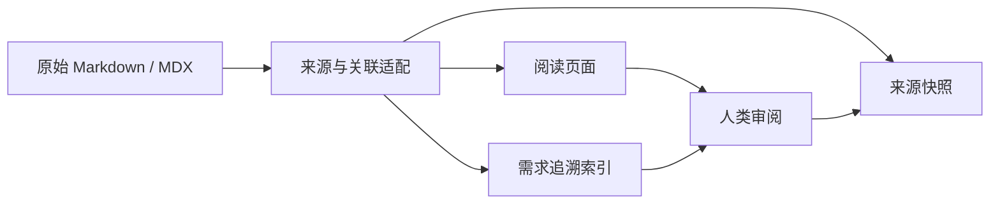

# Agent VM 文档技术方案与工程组织

## 范围与证据边界

- design-id: `DESIGN-DOCS-BOUNDARY`
- covers: `REQ-DOCS-001`, `REQ-DOCS-009`

本调研比较 Fumadocs 与 Rspress，目标为独立构建的 React 文档站，以及生产管理台和同源 Demo 中按需显示文档正文的帮助入口。以下将框架公开能力与项目需要自行实现的集成区分。未安装依赖、运行构建或进行性能基准测试，因此不据官方性能宣传判断两者速度优胜，也不把文档示例当作本项目兼容性验证。

## 已确认选型与推荐工程方案

- design-id: `DESIGN-DOCS-SOURCE`
- covers: `REQ-DOCS-002`, `REQ-DOCS-004`, `REQ-DOCS-007`

Fumadocs 选型已经确认。React、TypeScript、Vite 与 React Router 静态预渲染是推荐工程组合；Vite 支持是减少工具链差异的偏好，不是产品功能硬要求，首期依赖与构建配置已在 `docs-site/` 落锁，实际验证见[实现覆盖](../specs/documentation-review/IMPLEMENTATION.md)。完整目标可通过独立文档站和共享正文模块服务生产管理台与 Demo，但这不表示后续嵌入方案已经验证。

首期范围与验收已由[文档审阅 Spec](../specs/documentation-review/SPEC.md)确定：使用本次站点需求与设计材料，提供可筛选的需求追溯视图及独立可复现预览。先完成设计文档，再建设站点；本文件的完整目录、上下文帮助及组合交付设计属于后续目标建议。管理台嵌入验证、完整项目文档展示和生产／Demo 完整接入依次后置，不作为首期验收条件。

选择依据是 React 正文模块的复用和正式的 Vite／静态构建接入，而非未经测量的速度排名。完整站使用 Fumadocs 的导航、目录与搜索能力；页内帮助使用项目自己的轻量外壳，不把整个站点 layout 或路由器装入 popover。React Router 只进入文档站工程，不要求先迁移管理台的现有路由。

项目接受内容适配、交互组件和站点构建的维护成本，以获得文档导航、交互审阅和后续正文复用能力。同一篇正文只保留一个可编辑来源：既有长期合同继续使用 Markdown，富交互页面可以使用 MDX，站点构建读取来源或进行有界适配；不人工维护 Markdown 与 MDX 两份同义正文。Fumadocs 的独立浏览器正文入口是选型依据，管理台浮层、对象映射和章节定位仍需项目自行实现，属于后续阶段。

Fumadocs UI 选择其 Radix 版本，与管理台现有 Radix／shadcn 及 Tailwind 4 体系保持接近；官方新模板也提供 Base UI 版本，但不必为文档切换整个产品的基础组件体系。完整站可以使用自己的 RootProvider，嵌入正文只允许依赖共享模块提供的组件及局部上下文，不默认导入整个站点的 MDX 组件集合和全局 CSS reset。[官方安装说明](https://www.fumadocs.dev/docs/react-router/manual-installation)

React Router 支持关闭运行时 SSR 并预渲染页面，Fumadocs 提供对应配置和静态搜索说明；交付物可以只有 HTML、JS、CSS、字体和索引，无需常驻 Node 服务。预渲染阶段仍需要构建运行时，所有文档路径和静态搜索资源都需要枚举。[Fumadocs 静态构建](https://www.fumadocs.dev/docs/react-router/deploying/static)、[React Router 预渲染](https://reactrouter.com/how-to/pre-rendering)

从入口和部署看，管理台与完整文档站是两个 HTML 入口；完整文档站内部可以保留客户端导航。页内帮助则直接渲染 React 正文模块。这个组合不依赖 iframe，也不要求生产管理台与文档站共用一个 router。

## 首期最小工程布局

- design-id: `DESIGN-DOCS-ENGINEERING`
- covers: `REQ-DOCS-003`

首期保留既有正文路径，只建设独立 `docs-site/` 工程及其内部的来源适配、追溯索引和交互视图。下列是推荐的责任划分，不是已经生成的文件；构建读取仓库正文，生成目录不作为可编辑来源。

```text
agent-vm/
├── docs/specs/documentation-review/      # 需求、覆盖和背景的现有来源
├── docs/proposals/                      # 本次研究与设计来源
├── docs-site/                           # 首期独立站点
│   ├── package.json                     # 独立构建、预览与检查入口
│   ├── app/                             # 阅读页面、导航与交互追溯
│   ├── content/                         # 来源清单、适配与关联索引生成
│   └── .generated/                      # 生成索引与来源身份，不手工编辑
└── .agents/skills/documentation-review/  # Agent 文档审阅工作指引
```

来源清单只声明要接入哪些文件及其页面映射，不能复制需求正文或已有验收关联。来源适配和正文呈现保留模块接缝，首期不创建管理台帮助入口、组合部署脚本或跨应用共享包；后续出现第二个实际消费者时，再将需要共享的能力提取到 `packages/docs/`。根目录的依赖与命令接入只服务独立站点开发，不要求重构现有管理台。

## 首期需求追溯适配

- design-id: `DESIGN-DOCS-TRACE`
- covers: `REQ-DOCS-005`, `REQ-DOCS-006`

追溯索引直接读取 `SPEC.md` 中的 `REQ-*`、`VER-*` 和 `covers:`。设计依据采用原始设计段落上的稳定标识与显式需求关联，一段设计可以关联多个需求，一项需求也可以有多个设计依据。关联声明的具体语法随首期适配验证确定，须保留普通 Markdown 阅读能力；站点由原始声明生成索引，作者无需维护第二份正文或同义追溯表。

交互视图先列出需求，允许筛选或选择，再展开设计与验收关联；点击关联可定位对应原文。索引分别保留尚未关联、引用目标不存在和关联声明无法解析的诊断，并暴露来源位置；追溯问题不会单独阻止生成预览。未关联条目的说明不等于自动豁免或验收通过，完成条件仍按 Spec 检查。

首期人工验收使用本次真实材料完成“选择需求 → 查看设计依据 → 查看验收依据 → 定位原文”，再通过受控案例检查缺少关联的展示，由项目负责人确认查找成本改善。构建时间另外测量，不能以构建性能代替审阅价值判断，也不要求首期增加正式的人类计时实验。

## 后续完整目标布局

以下是包含后续嵌入的完整目标布局示例，不是首期必须创建的文件清单。保留现有 `docs/specs/`、`docs/adr/`、`web/` 和 Go 模块位置；新增工程文件尚未创建。

```text
agent-vm/
├── package.json                         # Bun workspace 与组合构建入口
├── bun.lock                             # 共用锁文件
├── PRODUCT.md / GLOSSARY.md              # 既有产品与术语来源
├── docs/                                # 内容来源，不放站点应用代码
│   ├── architecture/
│   ├── specs/
│   ├── adr/
│   ├── proposals/
│   └── guides/                          # 新增面向使用者的说明
│       └── vms/
│           ├── release.mdx              # 完整页面，组合可复用内容
│           └── _release-access.mdx      # 页内帮助与完整页共用片段
├── packages/
│   └── docs/                            # @agent-vm/docs，共享文档模块
│       ├── package.json
│       ├── source.config.ts             # 共用 collection 与编译配置
│       ├── catalog.ts                   # docId、来源、URL、章节与导航声明
│       ├── build/
│       │   ├── manifest.ts              # 生成浏览器可读的清单
│       │   └── links.ts                 # 源路径、锚点及资源适配
│       ├── src/
│       │   ├── target.ts                # DocTarget 与完整文档 URL
│       │   ├── DocContent.tsx           # 无站点 layout 的正文渲染入口
│       │   ├── components/              # 两种阅读入口共用的 MDX 组件
│       │   ├── exhibits/                # 时间轴、状态图等交互内容
│       │   └── styles.css               # 作用于文档容器的样式
│       ├── scenarios/                   # 交互示例的共享数据
│       ├── tests/                       # 来源、URL、片段与渲染合同
│       └── .generated/                  # 自动生成，忽略，不手工维护
├── docs-site/                           # 独立完整文档站
│   ├── package.json
│   ├── vite.config.ts
│   ├── react-router.config.ts           # /docs/ 与静态预渲染
│   └── app/                             # Fumadocs layout、路由、静态搜索
├── web/                                 # 既有生产与 Demo 管理台
│   ├── src/help/
│   │   ├── HelpProvider.tsx             # 页面／对象／字段上下文
│   │   ├── HelpButton.tsx
│   │   ├── HelpPanel.tsx                # popover／侧栏／移动端对话框
│   │   └── bindings.ts                  # UI 语义目标到 DocTarget 的映射
│   └── src/app/、src/demo/               # 既有代码
└── bin/
    └── assemble_site.ts                 # 组合 web 与 /docs/ 静态产物
```

目录分工为：`docs/` 拥有知识正文，`packages/docs/` 拥有内容加载和呈现能力，`docs-site/` 拥有完整站外壳，`web/src/help/` 拥有管理台的上下文和浮层交互。文档模块不依赖 `web/src/app`，站点不直接依赖管理台业务状态；两者都通过共享模块取得内容。

共享模块应区分构建入口与浏览器入口，例如 `@agent-vm/docs/build`、`@agent-vm/docs/react` 和 `@agent-vm/docs/targets`。`source.config.ts`、文件系统扫描及 Fumadocs source loader 不可从浏览器入口间接导入。React／React DOM 使用统一的 workspace 版本和 peer dependency；站点与管理台分别打包时可以各自生成运行时代码，不承诺两个独立构建只编译或下载一次。

交互组件和示例数据由共享模块持有，不能通过导入整个管理台 App 来复用图表。若后续出现真实的跨产品 UI 复用需求，再提取相应基础组件；不为这次文档集成预先搬迁全部 shadcn 或既有页面。

## 后续上下文帮助建议

帮助目标使用稳定标识，避免将源文件路径、中文标题或当前实例 ID 写在业务按钮中。以下仅示意接口，不代表已实现的 SDK：

```ts
type DocTarget = {
  docId: string;
  sectionId?: string;
};

const releaseHelp: DocTarget = {
  docId: 'guide.vm.release',
  sectionId: 'access-and-cache',
};

// HelpPanel 内渲染，不依赖完整站 router。
// <DocContent target={releaseHelp} mode="embedded" />
// 完整文档由同一清单解析为 /docs/...#access-and-cache。
```

`docId` 标识主题文档，`sectionId` 标识稳定章节或明确注册的片段，两者由清单验证；URL 从清单和宿主文档根路径生成。文档语言与产品版本由宿主配置提供，不由每个按钮手写。未翻译时回退并显示实际语言，不将管理台已有双语支持等同于文档已经翻译。

上下文优先级建议为显式帮助按钮、最近选中的对象或字段、当前页面、文档首页。对于全局入口，点击按钮本身会改变焦点，因此不能在点击之后仅靠 `document.activeElement` 猜测之前的目标；页面和对象组件应主动注册语义上下文。打开后锁定阅读目标，用户切换对象时明确提供更新或返回方式，不在阅读中因鼠标移动自动换文。

短说明使用 popover，长文和交互示例在较宽面板中阅读，窄屏使用对话框或抽屉。两种外壳共用加载、错误、关闭、焦点恢复、链接处理和“新页面打开完整文档”行为。可以嵌入阅读全部正文，也可以为高频问题使用注册片段；不能将任意 MDX 按浏览器 DOM 截断并假设其 imports、状态和标题仍然正确。

例如 `_release-access.mdx` 拥有“访问撤销与缓存”的唯一用户说明和交互，`release.mdx` 导入该片段构成完整章节，嵌入清单将对应 `sectionId` 指向它。文件名前导下划线只是本项目约定，必须由 collection／路由清单显式排除，不能假设 Fumadocs 自动不生成页面。既有 Markdown Spec 可以先整篇加载后定位章节，无需为了短帮助拆散规范文件。

嵌入模式需要独立的锚点命名空间和容器内滚动处理，避免与管理台已有元素重复 ID；“完整文档”链接使用规范章节 ID。点击浮层中的文档链接时，能解析的目标在面板内切换，否则打开完整文档；不得把文档路由写入管理台当前 pathname。交互示例拥有本地状态，不直接调用管理 API 或改变 Demo 场景。

## 构建、版本与部署组织

内容扫描、路由和目标清单由共享规则生成；生产、Demo、独立文档预览分别消费。内容哈希、编译器及插件配置共同决定缓存身份，不把来源相同当作所有目标产物字节相同。开发时只启动正在修改的工程；文档编辑不需要反复构建 Go 二进制。

管理台只在打开帮助时加载需要的正文和交互代码，完整站的导航、搜索和目录不应进入管理台首屏依赖。浮层允许后续按主题预取，但不能为每个对象预加载整站。搜索采用构建生成的静态索引，延迟加载，避免为文档增加运行时服务。初期使用与适配插件相容的常规编译路径；实验性编译器或缓存只在真实测量证明收益后引入。

组合构建保留管理台根入口，将完整站 HTML、路由数据及静态资产按 `/docs/` 命名空间放入同一产物，避免两个构建的 `index.html`、assets 和搜索资源发生覆盖。生产组合产物进入既有 Go 嵌入和校验链；Demo 组合产物进入静态部署链。独立文档工程仍能单独构建与发布，URL 根路径通过一致配置解析。

产品随附文档与管理台绑定同一产品版本及来源提交，用户指南按适用实现范围发布；设计审阅预览绑定候选提交并保留候选身份。正式站与预览的页面范围由构建清单明确管理；隐藏导航不等于排除文件、索引或代码。新页面打开优先使用同一部署内的文档，不能默认跳转到未必匹配已安装版本的最新线上文档。

## 后续嵌入涉及的集成点

- [Web 构建配置](../../web/vite.config.ts)目前只有生产和 Demo 目标，均以 `/` 为 base；需要增加共享文档接入，并在组合阶段引入独立文档站输出。
- [统一服务静态托管](../../skills/agent-vm-ops/control/internal/webadmin/unified.go)目前按请求名读取资源，未命中时对无扩展名页面回退到管理台 `index.html`；不能直接将 `/docs/x` 交给现有 fallback。需要按实际预渲染输出清单解析文档页面、静态资源和缺失路径，避免错误返回管理台 HTML。
- [Demo 托管配置](../../web/edgeone.json)目前将所有路径重写到 `/index.html`；需要按托管平台实际规则先处理文档静态页和资源，再处理管理台深链。不能假定特定平台的目录索引优先级。
- [Web 资源打包](../../skills/agent-vm-ops/scripts/build_web_assets.ts)目前只构建并收集 `web/dist`；未来应收集完成组合的产品静态目录，并将文档 HTML、JS、CSS、索引和资源纳入现有版本／来源／校验和清单。

这些是实施时应修改和验证的明确位置，不是本研究已经完成的功能。Caddy 继续转发到同一产品服务；文档不新增独立业务服务或第二套认证与控制权威。

## 分阶段的性能与兼容性验证边界

- design-id: `DESIGN-DOCS-VALIDATION`
- covers: `REQ-DOCS-008`

首期在依赖落锁时需要验证本主题材料的 Markdown／MDX 兼容性、链接、锚点、图表、需求追溯交互及独立站点构建。具体验收以文档审阅 Spec 为准，完整项目文档适配不构成首期完成条件。

独立站阶段记录冷构建、单文档修改后的重建和预渲染开销，不预设未经测量的毫秒或体积承诺。管理台首屏增量、首次帮助加载、片段在面板与完整页复用、对象映射、面板焦点恢复及 Go／Demo 深链行为分别属于后续嵌入验证和正式接入阶段。

首期独立站点已按上述边界实现并完成本地构建；具体版本、测量与尚待完成的人工验收见[实现覆盖](../specs/documentation-review/IMPLEMENTATION.md)。本建议选择的是工程方案，不把独立浏览器 collection 或预渲染示例当作已有端到端能力。

## Fumadocs

Fumadocs Core 提供无样式组件和服务端内容工具，可以不使用 Fumadocs UI；其官方列出的 React 框架包含 React Router 与 TanStack Start。部分组件需要框架 provider，因此 headless 不代表正文中所有组件都无需上下文。[官方 Core 说明](https://www.fumadocs.dev/docs/headless)

Fumadocs MDX 有正式的 Vite 集成入口。官方完整应用入口分别提供 React Router 与 TanStack Start，而不是要求采用 Next.js。这使其与现有 Vite 技术体系接近，但仍需验证实际选定的 Vite、React、插件和路由器依赖组合；支持 Vite 不等于已经证明与项目锁定版本兼容。[Vite 集成](https://www.fumadocs.dev/docs/mdx/vite)、[React Router 快速开始](https://www.fumadocs.dev/docs/react-router)

浏览器 collection 提供 `createClientLoader`、`preload` 与 `useContent`，生成代码使用异步 import，示例直接取得编译后的默认 MDX React 组件并在自定义 `div` 中渲染。浏览器入口只开放 doc/docs collections。这是复用正文而不挂载完整站点 layout 的明确技术基础；它没有提供“管理台 popover 帮助系统”这一完整产品能力。[Browser Entry](https://www.fumadocs.dev/docs/mdx/entry/browser)

`fumadocs-core/source` 的 `loader()` 是服务端 API，不能直接塞入管理台浏览器 bundle。静态生产方案应在构建时产出页面路径、元数据和内容引用清单，再由浏览器入口按需导入正文；这属于项目 integration，而非浏览器中运行 source loader。[Loader API](https://www.fumadocs.dev/docs/headless/source-api)

官方仓库静态部署指南展示 React Router 关闭运行时 SSR 并预渲染文档路径，以及 TanStack Start 的 SPA/prerender 配置。因此生产可以交付静态资源，不必常驻 Node；所有动态文档路径必须被预渲染或由约定的 SPA fallback 承接，搜索也应选择静态索引路径。不能把 Next.js 的 static export 配置照搬到 React Router。[官方静态部署指南源码](https://github.com/fuma-nama/fumadocs/blob/dev/apps/docs/content/docs/(framework)/deploying/static.mdx)

## Rspress

Rspress 是基于 Rsbuild 的 React 静态站点生成器，提供文档主题、MDX、搜索和插件体系。它不是 Vite 插件方案；采用它意味着独立文档子项目保留另一条构建链。官方 SSG 能力适合静态托管与 Go 嵌入资源交付，但构建时的运行环境与生产无需 Node 是两个不同约束。[官方介绍](https://rspress.rs/guide/start/introduction)、[SSG](https://rspress.rs/guide/basic/ssg)

官方明确支持 MDX 中导入 React 组件和 MDX fragments，并支持 React 19。fragment 默认通过下划线文件名排除站点路由；动态交互适合 TSX，正文适合 MDX，因为 TSX/HTML 可能影响静态搜索信息提取。这支持同源交互 Demo，但不自动保证与管理台共享路由上下文或 CSS。[MDX 与 React](https://rspress.rs/guide/use-mdx/components)

Rspress 存在公开 runtime `Content` 导出，不能断言它没有正文出口。然而源码显示 `Content` 从 `useLocation()` 读取当前 pathname，再用 `pathnameToRouteService()` 匹配生成路由的 element；其 props 仅提供 fallback，并不是任意 `docId` 的独立内容加载器。直接在生产管理台调用它会依赖 Rspress 路由与生成运行时，不能视为现成的跨应用正文 SDK。[runtime 导出源码](https://github.com/web-infra-dev/rspress/blob/main/packages/core/src/runtime/index.ts)、[Content 源码](https://github.com/web-infra-dev/rspress/blob/main/packages/core/src/runtime/Content.tsx)

MDX fragment 在 Rspress 编译环境内可作为 React 组件导入，不等于其编译产物已经有受支持的对外 package/export 合同。若管理台保持 Vite，应另行验证是否共享原始 MDX 并配置统一编译，或设计可发布的内容包；不能直接承诺复制站点 chunk 即可复用。当前未核实存在类似 Fumadocs browser collections 的独立、按文档标识读取的公开跨构建内容导出 API。

## 对比与集成责任

| 维度 | Fumadocs | Rspress |
| --- | --- | --- |
| 构建体系 | 官方 Vite 集成，React Router/TanStack Start 应用路径 | Rsbuild 独立站点构建 |
| 正文模块复用 | 浏览器 collection 明确暴露编译 MDX 和异步加载 | MDX fragment 可导入；runtime Content 绑定当前站点路由 |
| 静态生产 | 路由框架预渲染配置，需枚举动态页 | SSG 站点交付 |
| popover/侧栏 | 项目自行实现外壳、映射与上下文适配 | 项目自行实现，另需解决内容跨构建边界 |
| 性能结论 | 未进行项目基准，不能排名 | 未进行项目基准，不能排名 |

两种方案都需要项目定义稳定 `docId`、`sectionId`、规范 URL 与上下文映射。管理台页面或聚焦对象应映射到该合同，帮助入口再选择 popover 或侧栏；“完整文档”使用规范 URL 加章节 hash。任意 MDX 正文不会自动具备可安全截取章节的模块边界，建议为短帮助编写独立可复用 fragment，并在完整文档组合，而非浏览器按 DOM 随意切割。

无论选哪栈，都必须处理同页重复 heading ID、站内链接转换、滚动容器与锚点定位、provider、Tailwind/reset 样式隔离、React 单实例、懒加载错误和可访问性。富交互 MDX 必须作为受信任源码编译，不能把任意外部 MDX 当数据执行。上述项目集成责任均不能包装成框架原生 popover 支持。

已有 `docs/*.md` 应保持单源，通过 collection 路径或构建输入映射接入，新增复杂交互内容使用 MDX。两栈对现有 Markdown 方言、相对链接、资源引用、缺少 frontmatter 和标题 slug 的实际行为仍需小型兼容性验证；本调研尚未证明无需迁移修订即可全量接入。

## 单源审阅数据流

正文与关联声明在原始材料中维护。构建适配器生成阅读输入、追溯索引及实际来源快照，浏览器只消费这些产物。


