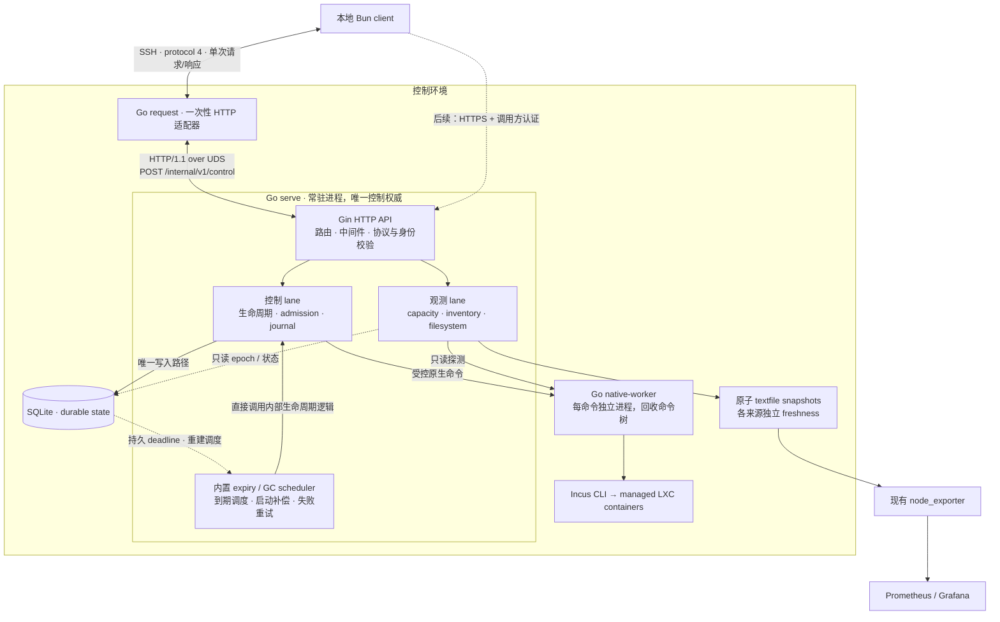
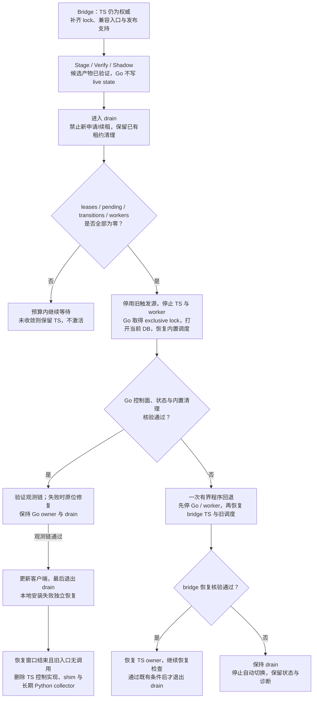

# Agent VM Go 父级服务设计与技术选型

本文是供审阅的设计建议，整理 Go 常驻服务接管控制与观测的目标、选型和迁移条件。
它不表示功能已经实现，也不替代当前 [Agent VM Spec](../specs/agent-vm/SPEC.md)、[CLI 合同](../specs/agent-vm/contracts/cli.md)、[观测合同](../specs/agent-vm/contracts/observability.md) 和 [发布合同](../specs/agent-vm/contracts/release.md)。

## 1. 目标与当前事实

目标是在控制环境内运行一个 Go 常驻服务，由它独占 Agent VM 的控制状态、原生操作编排和观测采样，最终移除 TS/Bun 控制实现与 operator 侧长期运行的 Python collector。
Go 服务使用 Gin 提供明确的 HTTP API，接收并分发控制请求、健康检查和观测快照读取。
本地 Bun 客户端仍通过 SSH 发出一次请求并获得一次响应；远端一次性适配器把请求转成 HTTP over UDS 交给 Gin，再把结果映射回现有 CLI envelope，不增加客户端轮询或隐式续租。

| 当前事实 | 对设计的约束 |
| --- | --- |
| [控制入口](../../skills/agent-vm-ops/scripts/agent_vm_control.ts) 是 TS/Bun 一次性进程。 | Go 必须接管实际控制职责；迁移后的 TS 入口只能临时转发。 |
| [SQLite store](../../skills/agent-vm-ops/scripts/control-store.ts) 保存任务、端口、operation journal、audit 和 metadata。 | 保留 durable state 和 generation，不以重建数据库完成切换。 |
| [native runner](../../skills/agent-vm-ops/scripts/control-native.ts) 依赖单进程命令串行化与进程树回收。 | 不能直接把现有全局 child-process 回收方式搬进并发 daemon。 |
| [systemd 集成](../../skills/agent-vm-ops/scripts/control-systemd.ts) 包括 generation 绑定的 expiry、boot reconcile 和 age GC。 | 目标由程序内置调度接管；SQLite 中的截止时间、启动补偿和失败重试必须覆盖现有持久 timer 的恢复职责。 |
| [客户端](../../skills/agent-vm/scripts/client.ts) 固定调用远端 Bun 控制入口。 | 必须先建立兼容入口，再更新客户端，最后删除兼容入口。 |
| CLI 合同要求 observation epoch、一致性重试与采样起点时间；当前控制实现尚未完整提供这些行为。 | 测试 fixture 中存在字段，不等于当前实现已经满足合同；桥接阶段需补齐。 |
| 当前语言政策以 Bun 为 Agent VM 的默认 runtime；根测试发现器尚不发现 Go tests。 | Go 需要明确的语言边界例外、测试接线与发布产物合同。 |

operator collector 的部署拓扑、真实 scrape 配置和宿主服务状态不能由本仓库推断。
以下方案将这些内容保留为上线前核验项，不把本地源代码审阅当作线上证据。

## 2. Style Playbook 依据

本次读取的 playbook 基准为 commit `c50580cdda37b2608a249e94e2ff5d2f47bf5d43`。
下表中的文件标识相对于外部 playbook 的 `skills/style-playbook/references/`，并非本仓库路径。

| Topic / 项目证据 | 证据强度 | 本次采用的结论 |
| --- | --- | --- |
| `topics/ops-tool/TOPIC.md` | high；证据窗口截至 2026-09-10。 | 显式配置、安全默认值、幂等操作、审计和恢复路径是主要接口；HTTP 路由也必须遵守这些边界。 |
| `topics/rust-web-service/TOPIC.md` | high；证据窗口截至 2026-10-13。 | 借鉴 HTTP route、bind/auth、转发目标、观测隔离和 graceful shutdown 的服务边界；语言与框架按 Go 约束选定。 |
| `topics/sqlite/TOPIC.md` | high；证据窗口截至 2026-05-01。 | 单节点服务可以正式采用 SQLite；明确文件路径、写入所有者、备份和 schema 边界。 |
| `topics/persistent-state-migrations/TOPIC.md` | medium；owner policy，完整项目采用证据仍有限。 | 程序回退不自动回退持久状态；结构变化与数据转换分开记录、排序和验证。 |
| `projects/dockrev.md` | public / current / high；2026-10-06 核验。 | 借鉴通过框架路由进入运维服务、统一处理失败与恢复的边界；Go 使用 Gin 承担相应 HTTP 入口职责。 |
| `projects/proxy-broker.md` | public / current / high；2026-08-16 核验。 | 借鉴单 artifact 与明确 SQLite ownership；其 embedded admin UI 和 Web 认证面不在本次范围。 |

另核对 `semver-change-governance` 的分类边界：本建议分别描述 wire、manifest 和 durable state 的兼容性，不据此引入新的版本号、label 或发布流程。
这些 Topic 没有规定 Go Web 框架、Go SQLite 驱动或 ORM；下面的具体依赖是结合本仓库约束作出的工程选择，不能称为 playbook 已有的 Go 默认栈。

对 `ops-tool`、`rust-web-service`、`sqlite`、`persistent-state-migrations` 的本地 Policy 审计完成，结果为 `not-aligned`：`persistent-state-migrations` 的项目 Policy package 与 lock 证据缺失。
本文没有安装 Policy，也没有写入 Topic adoption record。
若后续明确采用该 Policy，安装入口如下，安装本身另需 owner 授权：

```text
npx skills add IvanLi-CN/style-playbook-skills --skill persistent-state-migrations --yes
```

## 3. 推荐技术栈

| 层面 | 选择 | 理由与边界 |
| --- | --- | --- |
| 语言与构建 | Go 1.27 系列、Go modules、`CGO_ENABLED=0`。 | 原生常驻进程；控制端发布一个 binary，运行时不安装 Go。构建时固定补丁版本和完整依赖图。 |
| Web 框架 | Gin v1，`github.com/gin-gonic/gin`。 | 作为实际 HTTP API 入口，负责固定路由、请求中间件、错误处理和内部服务分发；具体版本随 module 锁定。 |
| 外部传输 | 现有 SSH + stdin/stdout 单次 JSON 请求。 | 保留 protocol 4、客户端 journal、明确的超时与身份匹配。 |
| 本机传输 | `net/http` + HTTP/1.1 over Unix domain socket。 | Gin 挂载于受控 `http.Server`，请求适配器使用固定 UDS transport；采用 HTTP framing，无需自定义长度帧。 |
| 持久层 | SQLite + 标准库 `database/sql` + `modernc.org/sqlite`。 | 保持当前数据库；纯 Go 驱动适合无 CGO 构建与固定产物发布。 |
| SQL 与迁移 | 手写参数化 SQL、显式 transaction 和迁移记录；无 ORM。 | 当前 schema 小，generation、journal 与提交结果比对象映射更重要；首轮无需 GORM、Ent、SQLx 或代码生成。 |
| Linux 机制 | `golang.org/x/sys/unix` + 标准库 `os/exec`。 | 封装 `flock`、peer credentials、subreaper、pidfd 和精确进程回收；Linux 专属代码与 portable core 分离。 |
| Incus 集成 | 类型化 adapter 调用现有 `incus` CLI，包括 `incus query`。 | 首轮沿用已验证的原生边界，不同时切换 Incus SDK、认证和控制实现。 |
| 配置与日志 | 保留 canonical JSON config；标准库 `flag`、`log/slog`，日志进入 journald。 | Gin 中间件复用结构化日志与错误合同；HTTP response、CLI stdout 和日志分离。 |
| 观测输出 | Prometheus textfile + 现有 node_exporter。 | Go 负责采样与编码；不引入新的 exporter HTTP 服务或 Pushgateway。 |
| 生命周期 | systemd service + 程序内置 expiry/GC scheduler。 | systemd 启动和重启进程；程序依据持久状态安排到期回收、缓存清理与启动补偿，不依赖外部 expiry timer 或 cron。首轮不使用 socket activation。 |
| 测试 | Go `testing`、`go test`、`go vet`、Linux race/native tests；保留 Bun/Python 合同测试。 | 将 Go module 显式接入根验证入口，不以 macOS skip 作为 Linux 行为证据。 |

Go 发布系列依据 [Go Release History](https://go.dev/doc/devel/release)；具体补丁与依赖版本在建立 module 时锁定，并写入 release build metadata，不使用浮动 `latest`。
数据库接口见 [`database/sql`](https://pkg.go.dev/database/sql)；所选驱动的无 CGO、连接参数及依赖约束见 [`modernc.org/sqlite`](https://pkg.go.dev/modernc.org/sqlite)。
选型接受该驱动的依赖体积与 CPU 成本风险，实施时以本项目 workload 验证，并按驱动要求保持 `modernc.org/libc` 版本一致；这里不宣称纯 Go 比原生 SQLite 更快。

Gin 的职责是接收 HTTP 请求并路由到 control/observe 服务，业务状态机保留在框架之外；框架确实位于转发路径上。
使用 `gin.New()` 显式注册中间件，并由 `http.Server{Handler: engine}` 在 UDS listener 上提供服务；这组合了 Gin 的 `http.Handler` 接口与 Go 的 listener 支持，见 [Gin 自定义 HTTP 配置](https://gin-gonic.com/en/docs/server-config/custom-http-config/) 和 [`http.Server.Serve`](https://pkg.go.dev/net/http#Server.Serve)。
首轮 HTTP API 通过本机 UDS 暴露，继续使用 SSH 作为跨机器入口；浏览器控制台及直接跨机器 HTTP 访问另行定义部署认证与授权合同。

保留 SSH 的依据是当前客户端在 [client.ts](../../skills/agent-vm/scripts/client.ts) 中固定以 SSH 启动远端控制命令，现有部署也以该入口承载控制访问。
`SSH → request → HTTP over UDS → Gin` 是首轮兼容迁移选择：客户端继续使用既有入口，Go 服务独立常驻，UDS 提供本机 HTTP 连接和权限边界。
Gin 可以直接服务 HTTPS；若选择 `client → HTTPS → Gin`，就能移除一次性适配器，但必须同时设计客户端 HTTP transport、服务身份验证、调用方授权、TLS 和部署监听配置。
两条路线都能保留 protocol-4 body 与 operation identity；采用 SSH 并不是协议格式的要求，也不是 Gin 的限制。

采用决策：首轮保留 SSH 兼容链路，同时将“客户端到父级服务的连接可以完全移除 SSH”作为架构约束。
Gin handler 与业务服务不依赖 SSH 环境变量、会话或进程；传输入口完成认证后，向业务层提供经过校验的调用身份与请求。
后续接入 HTTPS client、TLS 与调用方授权即可替换入口并删除 SSH 适配器，复用同一 HTTP API、生命周期、SQLite、generation 和 operation journal；届时按既有客户端支持窗口退出兼容。
该已确认边界记录在 [ADR 0034](../adr/0034-agent-vm-transport-independent-control.md)；Control authority 与 Control request adapter 的定义见[术语表](../../GLOSSARY.md#agent-vm-control-plane)。
到期清理由程序内置调度和执行，已确认的职责边界记录在 [ADR 0035](../adr/0035-agent-vm-built-in-expiry-cleanup.md)。

## 4. 进程、权限与接口

### 目标架构



图中 textfile 到 node_exporter 表示同 filesystem scope 的默认通路；跨 scope 时插入第 6 节的只读 relay。
实线表示首轮 SSH 兼容通路，客户端到 Gin 的虚线表示后续可独立启用的 HTTPS 替代入口。
控制与观测共享一份内部资源语义，各自使用有界 lane；worker 是执行隔离进程，SQLite 的写入权仍归 daemon。
到期清理走 scheduler 到 lifecycle 的内部调用路径，不经过 SSH、请求适配器或 HTTP；systemd service 只负责整个 Go 程序的启动与重启。

### 入口与权限

一个 binary 提供 `serve`、`request` 和内部 `native-worker` 三种运行方式。
`serve` 是唯一控制权威，持有 SQLite 写权限、生命周期状态机、admission 和调度器。
`request` 是一次性 HTTP 适配器，把 protocol-4 JSON 原始 bytes 作为固定 HTTP endpoint 的 body，校验响应后还原 CLI 输出与 exit code；它不读取数据库、不调用 Incus、不拥有第二套策略。
`native-worker` 每次只执行一个经 daemon 构造的原生命令并回收其子孙进程，不参与状态决策。

| 接口 | 约定 |
| --- | --- |
| SSH 入口 | 固定受保护命令；接收一个 protocol-4 请求，成功 stdout 一个 JSON envelope，失败 stderr 一个匹配的 JSON error。保留现有 exit code 与 archive stream 边界。 |
| UDS | 建议 `/run/agent-vm-native/control.sock`；父目录 root-owned 0700，socket 0600，并校验 peer credentials。外部请求不能指定 socket、配置、DB 或可执行文件路径。 |
| HTTP API | 内部 route namespace 为 `/internal/v1`，由 Gin 处理；control body 保留 protocol 4。只允许固定 method/path，不接受任意 URL、upstream 或通用 reverse-proxy 目标。 |
| HTTP client | 使用固定 UDS `DialContext`，禁用环境代理和自动 redirect；只转发 allowlist 内的 method、path 与 header，一次 CLI 调用完成一次业务请求。 |
| HTTP 边界 | header 上限 8 KiB、`ReadHeaderTimeout` 5 秒，control body 上限 2 MiB；业务 deadline 按 action 预算传播，不能用短全局 HTTP timeout 截断长启动操作。 |
| 超时与输出 | 继承普通操作 240 秒、启动类操作 600 秒的客户端预算及现有 action/native 子预算；stdout 2 MiB、stderr 64 KiB 的客户端边界保持一致。排队时间计入总预算。 |
| 身份与不确定性 | 保留 `action`、`session_id`、`generation`、`operation_id` 及 capabilities。断连、取消或超时不证明原生副作用未发生；保留 pending journal，按原 operation ID 查询或重试。 |
| 兼容校验 | daemon 启动验证 release manifest 和实际 artifact；每次请求验证 action 的 protocol/schema/semantic 窗口。活动 binary 与资源不可原地覆盖，只通过受保护发布器切换。 |

### HTTP 路由与转发语义

| Gin route | 消费方与行为 |
| --- | --- |
| `POST /internal/v1/control` | SSH `request` 适配器及受保护的运维调用；读取完整有界 body，用 protocol codec 验证，再分发到既有 action handler。内置 expiry/GC 直接调用同一内部服务。 |
| `GET /internal/v1/health` | 受保护的本机发布/运维检查；报告进程存活与 startup reconcile 就绪状态，不执行 native mutation。尚未就绪返回 503；就绪不等于允许新 admission。 |
| `GET /internal/v1/snapshots/:source` | operator relay 经固定 `request --snapshot SOURCE` 入口读取已生成快照；`SOURCE` 仅允许 `capacity`、`inventory`、`health`，不触发重新采样或开放任意文件读取。 |

Gin 中间件统一执行来源校验、大小限制、deadline、结构化日志和 panic recovery；只记录有界身份与结果，不记录原始请求 body、凭据或任意 query。
handler 把 operation identity 与 `Request.Context()` 交给内部服务，不把 `gin.Context` 传入生命周期或持久层；daemon shutdown 先关闭新 admission、处理在途状态，再有界关闭 HTTP server。
VM 的 TCP/UDP 端口映射继续由 lifecycle 协调 Incus proxy，并进行 lease、generation 与 ownership 检查。

control 的 HTTP 200 对应成功 envelope，已知输入/业务失败使用明确的 4xx 或 503，未处理内部故障使用 500；响应另带固定 `X-Agent-VM-Exit-Code: 0|2|3`，分别对应 CLI success、`ControlError` 和 `internal_error`。
适配器只有在 HTTP status、content type、exit-code header 与完整 envelope/请求身份相符时才向 stdout 或 stderr 原样输出；EOF、redirect、非 JSON、截断或身份不匹配都保留操作结果不确定的语义。

JSON 使用显式数字类型和兼容 codec，保留大整数、整数与小数的身份差别，以及现有 canonical digest 的 Unicode、转义和浮点规则。
`encoding/json` 的普通 `map[string]any` 或单独 `UseNumber` 不能证明与当前 codec 等价，必须用既有 golden corpus 验证历史 journal 可重放。
control route 不使用 Gin 自动 binding/JSON serialization 代替现有 codec；使用有界原始 body 和 codec 生成的响应 bytes，避免框架重新编码改变数值或 digest，接口依据见 [Gin API](https://pkg.go.dev/github.com/gin-gonic/gin)。

服务沿用当前控制权限边界，公开入口只允许既有 action allowlist，不提供任意命令执行、任意路径或通用 root RPC。
systemd sandbox 配置应根据 Incus、`/proc`、pidfd 和 systemd 操作的实际需要逐项验证，不能先套一个会破坏控制行为的通用模板。

## 5. 状态、并发与原生执行

### SQLite 与单一写入者

首轮保留现有 `meta`、`tasks`、`ports`、`operations`、`audit` schema 和历史字段含义，只增加旧程序可忽略的 metadata key。
沿用 WAL、`synchronous=FULL`、foreign keys 和 10 秒 busy timeout；每个物理连接都应用固定 PRAGMA，并在启动时核验。
写池限制为一个连接，读池限制为两个只读连接；短事务之外完成原生采样、命令等待和输出编码，禁止在 transaction 中等待 Incus、timer 或 guest。
写事务使用明确的 `BEGIN IMMEDIATE` 语义；提交失败时保持 `state_committed` 的确定或未知结论，不能统一当作无副作用失败。

数据库路径只来自 canonical config，保留真实父目录、owner、mode、symlink 和锁文件检查。
daemon 正常启动必须打开已存在且经过版本检查的数据库，不能因路径拼错或文件丢失自动创建空库；初始 provisioning 使用单独的明确入口。
备份使用 SQLite 一致性备份或已停写的完整数据库集合，不复制运行中的单个主文件来假装已备份 WAL state。

增加独立的 authority lock：Go daemon 生命周期持有 exclusive lock；桥接 TS 控制进程每次在触及 DB/native 前持有 shared lock。
该锁与短时 `control.lock` 分开，所有受支持入口都必须遵守；进入 Go backend 的兼容 shim 转发时不持有 shared lock，避免阻塞 daemon。
发布器只在旧 owner 及其 worker 全部退出后切换 backend；不容许 TS 与 Go 同时写 live state。

### 操作编排

保留 session/object lock、admission fence、generation 校验、原生资源 ownership 复核和 operation journal 语义。
mutations 先登记 intent，再执行 native phase，最后确认结果；重复 ID 只重放已确认结果，摘要不同则拒绝，pending 不自动重新执行不确定原生动作。
`renew` 原子提交新 deadline 与结果，再通知内置 scheduler 更新计划；内存通知丢失由持久状态重扫恢复，不能让旧计划覆盖已提交续租。
drain 中按现有语义拒绝 lease extension，不能因迁移到常驻服务而悄悄改变续租规则。

控制动作与观测使用不同的有界执行 lane，生命周期操作按对象串行，跨对象并发受统一上限约束。
同一 Incus subsystem 的限流要对两类 lane 生效，但慢 inventory 不得占满控制队列；总预算耗尽或队列满时返回明确错误，不无限堆积 goroutine。
重新采样原生状态后提交 reservation 时，必须复核 generation、admission epoch、drain 和当前资源总额；CPU/memory/disk admission 继续只有一份实现。

### 原生 worker

每个 worker 独立管理自己的命令树，使用 process identity、subreaper、pidfd 与有界 stdout/stderr，覆盖 `setsid` 逃逸、继承 pipe、超时和异常退出。
daemon 还必须登记 worker 的身份与 operation 关联；重启时先确认上次 worker 已清理、在运行或结果不确定，再允许冲突动作。
不能让多个 goroutine 共享当前“一次性进程拥有所有后代”的全局回收逻辑，也不能只依赖 `exec.CommandContext` 杀直接子进程。
Linux 机制通过 [`golang.org/x/sys/unix`](https://pkg.go.dev/golang.org/x/sys/unix) 封装；worker 不接受外部 argv，不拥有 DB、租约或 admission 权限。

## 6. 观测与内置清理

### 观测采样

capacity、inventory、guest filesystem 分别调度、分别限时；建议初始周期为 10 秒、30 秒、15 秒，同一采样未完成时合并或跳过下一次触发。
`admin metrics` 与 `admin status` 仍按请求进行有界的新采样，复用同一内部 sampler，不能静默改成返回后台旧 cache。
后台 snapshot 用于 textfile 和 relay，不是第二个 admission 真相源。

采样先读取 durable observation epoch，在 SQLite 锁外探测 native state，再读取 epoch；不一致最多尝试三次，最终仍不一致则显式报告。
epoch 只在实际 durable change 成功提交时递增；读取、no-op、回滚和纯观测不递增。
`observed_at` 是最后一次采样窗口的起点，缺失或无法验证的数据保持 `null` 或合同规定的省略形式，不能伪装为零或健康值。

textfile 分成 capacity、inventory、health 三类固定文件，每个 metric family 只由一个文件负责；同目录临时文件写完后 atomic rename。
inventory 失败时更新其独立的 up/freshness 状态，保留有效 capacity；保留的旧 inventory 数值必须能通过 source freshness 判为不可用，下一次成功完整替换 task 集合以移除旧行。
既有 `agent_vm_up` 保持 capacity source 的含义，inventory 和 filesystem 使用独立健康指标；dashboard 不能用一个来源的成功替另一个来源背书。
node_exporter textfile 不支持 sample timestamp，因此通过单独的时间 gauge 暴露源采样时间与 freshness，见 [Textfile Collector 文档](https://github.com/prometheus/node_exporter#textfile-collector)。

如果 node_exporter 与父级服务不在同一 filesystem scope，operator 侧增加短生命周期的非特权 Go relay，通过现有 SSH 只取已生成快照并原子落盘。
relay 调用固定 snapshot 入口，由一次性适配器经 Gin 的只读 snapshot route 取回；快照源采样时间与 freshness 随内容保留。
relay 不再采样 Incus、不访问控制 DB、不持有租约决策；取回失败必须使 relay freshness 失效，不能以旧快照更新时间冒充源成功。
真实拓扑核验后再决定是否部署该 relay；Gin snapshot route 与 control route 使用同一受保护 UDS listener。

### 内置到期调度与重启补偿

到期清理是 Go `serve` 的内置职责：scheduler 直接调用内部 lifecycle，不依赖 SSH、Gin listener、外部 cron 或按租约生成的 systemd timer。
SQLite 中的 `task_id`、`generation`、`lease_expires_at` 和生命周期状态是恢复依据；内存定时队列只用于唤醒，不是第二份租约真相源。
用有界调度循环安排最近的 deadline，并周期重扫持久状态以修复提交后通知丢失、调度遗漏和系统时钟变化；等待预算使用单调时钟，到期判定复核持久截止时间。
acquire、renew、release 等动作在 durable commit 后通知 scheduler；旧 generation 或旧 deadline 的唤醒必须在对象锁内重读当前记录，已续租、已释放或已替换的记录不执行过期清理。

到期后沿用 lease-end 语义：撤销访问、清除精确归属的映射/流并停止 VM，再允许复用；保留的 stopped cache 仍按既有策略回收，不因“内置清理”变成到期立即删盘。
清理失败保留可恢复的生命周期状态和审计，按有界退避重试；原生结果不确定时先复核 ownership 与实际状态，未确认清理完成的 slot 不得重新分配。
调度器为到期回收保留执行能力，不能被普通请求或慢观测长期挤占；同一对象仍串行执行，不能另起一套绕过 journal 或锁的删除路径。

原来的 boot reconcile 进入程序 startup reconcile；age GC 保持每 15 分钟的既有维护节奏，由内置 scheduler 触发，启动时补扫已符合回收条件的缓存。
age GC 继续只处理满足既有回收条件的对象，不能撤销有效租约；停止期间错过多个周期时合并成一次补扫，不制造无限任务积压。
启动时先读取当前 DB，重建计划、补处理已到期记录，并复核未完成操作和遗留 worker；恢复条件未满足时保持 admission 关闭，查询与诊断仍可用。
不会自动续租或重启 guest，也不会盲目重放结果不确定的原生动作。

程序整体停止期间无法执行回收，租约截止时间仍然有效；恢复后优先补处理，不能把停机时间补成租约延期。
systemd 的职责是监督和重启 Go 进程；不保留另一套独立 expiry 控制器。
需要暴露 scheduler 健康、待回收数量和最久逾期时间，并由独立监控发现进程停止或清理持续失败；上线前实测正常调度延迟和重启后的补偿时间。

旧 expiry/boot/age-GC units 仅在 TS 仍为权威的桥接阶段保留；Go 接管时按已验证的精确目标停用旧触发源，避免两套调度同时控制资源。
程序回退时，bridge TS 从同一份当前 DB 恢复自己的 timer 与 reconcile 路径，不恢复旧 deadline 或旧数据库快照。

## 7. 发布、切换与恢复

第一轮采用冷切换：候选 artifact 先 stage/verify，随后进入 drain；drain 拒绝新 lease acquisition、restart admission 和 renew，等待 effective leases、pending operations、task transitions 和 native workers 全部为零后再激活。
等待期间保留 TS 现有 expiry/GC 能力，不强制 kill guest，不把长 lease 等待塞入现有默认 300 秒的 publisher 收敛预算；drain 等待与 activation 各有明确预算。
达到切换条件后才停用旧 timer/boot 触发源，确认旧 owner/worker 退出，再由 Go 取得唯一控制权并启动内置调度。



切换和程序回退均打开同一份当前数据库；不恢复旧快照、不重置 generation。
纯观测故障停留在观测修复阶段，不进入控制 owner 回退分支。

| 阶段 | 进入与退出条件 |
| --- | --- |
| Bridge | 先发布仍以 TS 为权威的桥接版：补 authority lock、观测合同缺口、兼容转发能力及 manifest 支持。原 wrapper 的固定 allowlist 不能自行安装未知目标；若需扩展 wrapper，先由 operator 单独安装已审阅版本。 |
| Shadow | Go 只读数据库一致性副本或固定 fixture，native 仅允许只读探测；禁止 live DB 写入、启用清理调度、修改旧 timers、guest mutation 或碰生产 textfile。比较归一化语义和错误，而非要求时变采样逐字相等。 |
| Drain | 固定发布者身份，拒绝新 lease acquisition、restart admission 和 renew，保留已有租约的查询、释放、到期清理与必要恢复能力，并等待冷切换条件。超时保持旧 owner，记录尚未收敛的对象，不越权清理。 |
| Activate | 记录旧触发源与恢复信息，按精确目标停用旧 expiry/boot/age-GC 调度，停止旧 owner/worker，确认 authority lock 已释放，原子切换已验证 release，启动 Go 执行 startup reconcile 并恢复内置调度。TS 兼容入口此后只负责转发。 |
| Verify | 验证 state/generation、journal、原生 inventory、内置 deadline/GC 调度、旧触发源已停用、capacity、epoch、一致性和各观测来源。通过后更新本地客户端，最后退出 drain。 |
| Recover | 控制面健康失败允许一次有界程序回退；先停止 Go/worker，释放 authority，再恢复已验证 bridge release，由 TS 根据当前 DB 重建 expiry/维护调度。切换中途失败也必须恢复被停用的触发源。回退失败保持 drain；纯观测故障优先修复观测链，不触发控制 owner 来回切换。 |
| Retire | 确认全部受支持客户端已更新、旧入口无调用且恢复窗口结束，再删除 TS 控制实现、shim、旧 unit 调用和长期 Python collector。不得无限保留双实现。 |

Go 写入后的同一份数据库必须能被受支持 bridge TS 读取并完成其支持的操作，才能把程序回退列为可用恢复方式。
程序回退不恢复切换前数据库、不减少 generation、不清空 journal，也不自动执行 down migration；不满足向后可读约束的后续状态变化必须设计 forward repair。
DDL、当前数据 DML、历史 backfill 分开列出顺序、完成信号、暂停点和验证证据；备份恢复是独立 disaster recovery。

发布 manifest 增加 format 2，明确 binary 的 OS/arch、hash/mode、构建工具链、guest payload、service units、需退出或恢复的旧 timer/boot 资产、兼容 shim 和 client view。
release identity 继续绑定 source revision，外部 wire 保持 protocol 4；manifest format、内部 HTTP route version 与 wire protocol 分别演进。
固定 wrapper 继续只接受已声明的 stage/verify/activate/rollback/status 操作和精确目标，禁止客户端传任意目标路径或运行候选程序来“验证”它。
保留本地八文件客户端集合、sidecar-last 安装和现有本地 recovery record；本地客户端更新失败不反向回退已经健康的远端 owner。

## 8. 源码与交付边界

建议 Go module 位于 `skills/agent-vm-ops/control/`，包含 `cmd/agent-vm-control/` 和内部 `httpapi`、`protocol`、`state`、`lifecycle`、`scheduler`、`admission`、`native`、`observe`、`systemd`、`release` 包。
Gin 依赖集中在 `httpapi`；CLI HTTP 适配、protocol codec 和业务服务可独立测试，DB/lifecycle 包不依赖 Web context。
包按稳定职责划分，共享一份状态机和资源计算；不按旧 TS 文件逐一机械翻译，也不提前引入插件框架或通用 RPC 平台。

| 归属 | 保留或变更 |
| --- | --- |
| 公共仓库 | Go source、`go.mod`/`go.sum`、行为 fixtures/tests、通用 unit/template、固定 manifest/wrapper/publisher 合同、技术文档。 |
| 本地客户端 | 保留 Bun client、operation journal、source sync 和 guest helper；仅调整受支持的远端入口及 release metadata。 |
| Guest | 首轮保留已验证的 Bun guest root-growth/source-sync 行为；guest payload 在构建期生成并受 manifest 验证，不能在控制端临时安装 runtime。 |
| Operator | 真实 config、inventory、Incus project/pool/image、SSH material、服务安装和 `obs` 部署；dashboard、scrape、告警与 relay 拓扑由 operator 验证。 |
| Python | 删除被替代的长期 collector；一次性 publisher、manifest/wrapper 管理和必要行为测试可以保留，不把本次迁移扩大为全仓禁用 Python。 |

实施时需要同批修改以下合同表面，而非在本文中先宣告它们完成：

- Agent VM 的 Spec、CLI/observability/release contracts、IMPLEMENTATION 证据以及两个 Skill 的运行与部署说明。
- [Agent VM Spec](../specs/agent-vm/SPEC.md)、根 [AGENTS](../../AGENTS.md) 和 [README](../../README.md)：为 Go 控制进程划定明确例外，保留客户端与 guest 的 Bun 边界。
- 根 test runner、foundation consistency check、package scripts 和 CI：接入真实 Go tests、依赖前提和 Linux native 验证，不关闭现有 gate。
- 发布 manifest、固定 wrapper、publisher、client sidecar 及 unit assets：一起验证格式、目标集合与切换顺序。

## 9. 必须取得的验证证据

| 范围 | 验证重点 |
| --- | --- |
| Gin HTTP 与转发 | 真实 UDS 上的 route/method allowlist、peer credentials、header/body/deadline 限制、panic/error/exit-code 映射、原始数值 bytes 保留、redirect/任意 upstream 拒绝、snapshot source allowlist 与 freshness。 |
| 可替换传输入口 | 在不启动 SSH、也不提供 SSH 环境或会话的 HTTP handler 测试中调用同一 Gin API；验证相同业务请求的 envelope、identity、journal 与错误语义，确保 SSH 仅存在于兼容适配器。HTTPS 上线时另验 TLS、认证与授权。 |
| Wire 与 journal | protocol-4 corpus、超大整数与 canonical digest、身份/metadata 匹配、错误 exit、大小边界、重试与不确定结果；旧 Bun client 真实调用 Go request。 |
| Durable state | 现有 SQL baseline 升级、commit/rollback/磁盘失败、文件权限与 symlink、epoch 仅随真实提交变化、Go 写入后 bridge TS 读取与执行。 |
| Lifecycle 与 admission | acquire/renew/release/destroy/restart/resize/ports/drain/reconcile/GC；单 session 限制、generation、CPU PSI、memory reservation、disk admission 和精确 ownership。 |
| Linux native | 真实 flock、并发 worker、逃逸子孙进程、继承 pipe、timeout/kill/reap、daemon crash/restart，不允许残留 worker 被误当成已完成操作。 |
| Guest | grow-only、filesystem 证据、既有有界 retry/balloon 行为。 |
| 内置清理 | renew 与到期竞态、旧 generation/deadline 无副作用、提交后唤醒丢失、时钟跳变、清理失败退避、控制队列饱和、停机跨过 deadline 后启动补偿、admission 恢复顺序、age-GC 错过周期合并；HTTP/SSH 不可用时内置清理仍执行。 |
| Observability | 慢 inventory 不拖垮 capacity/控制、epoch 持续变化、无效值不归零、原子 textfile、无重复 family、旧 task 清除、源与 relay freshness 区分。 |
| Release | manifest 1/2 桥接、未知目标拒绝、候选 artifact 验证、冷 drain、旧调度退出与回退重建、切换中断、激活失败、单次程序回退、回退失败保持 drain、客户端安装失败独立恢复。 |

纯逻辑与协议测试可在 Linux/macOS 运行；Linux native、systemd、真实 Incus 和重型整体验证由会话 Agent VM 承担。
CI 明确区分 portable pass、native pass 和 unsupported skip，不把无权限环境下的跳过描述成集成成功。
本文件编写阶段只进行文档检查，以上测试均是实施验收要求，不是本次已获得的通过证据。

## 10. 备选方案与尚待核验项

驱动备选为 `database/sql` + `mattn/go-sqlite3`：适合已接受 C toolchain 且实测证明需要原生实现的场景，但增加 CGO 构建与交叉编译成本，见 [驱动构建要求](https://github.com/mattn/go-sqlite3#installation)。
只有在本项目的兼容性、内存或延迟测试使 `modernc.org/sqlite` 不达标时才切换；首轮保持同一 SQL/state 接口，避免把驱动选择传播进 lifecycle。

另一种路线是 Go 一次性控制程序配合独立观测进程与外部 expiry timers，能使回收不依赖常驻进程存活，但会继续保留外部业务调度和状态协调成本，不符合已确认的程序内置清理边界，因此不采用。
Incus Go SDK 与浏览器控制台留给具有独立需求的后续变更。

设计层面采用上述框架、驱动、内置清理边界和首次冷切换策略。
实施前仍需核验 operator 部署拓扑、目标 OS/arch、权限与可用内核机制、调度/重启补偿的延迟证据，以及受支持 bridge/client 的精确恢复范围；这些外部事实不能用设计建议代替。
获得实施授权后，先形成 Go 语言边界 ADR 与合同变更，再建立 module 和兼容测试，按第 7 节顺序推进，最终以第 9 节证据确认收敛。
