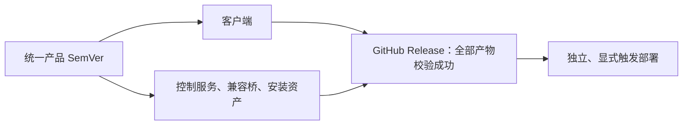
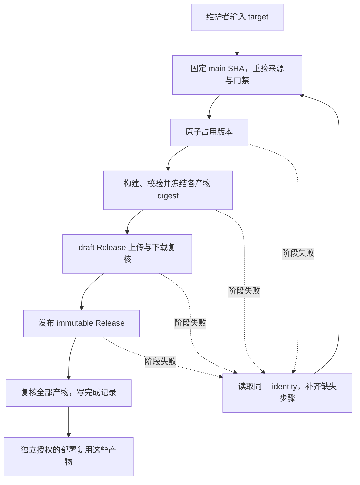

# Agent VM SemVer 与发布交付设计

本文是 Agent VM 项目工程治理中的发布子设计，负责产品版本、发布来源、不可变产物、发布记录、恢复，以及发布与部署的边界。
项目的完整需求以[项目工程治理 Spec](../specs/engineering-governance/SPEC.md)为准；日常变更兼容性、全部 PR/main 门禁、工作流调度与失败通知不因本文件以发布为题而缩减范围。
现状、差距和配置前置条件见[实现状态](../specs/engineering-governance/IMPLEMENTATION.md)。仓库侧实现已进入当前候选；平台规则、通知 transport、正式 tag/Release 和部署仍未启用。

## 已确认的产品合同

- 首个公开版本为 `1.0.0`，在公开接口合同与质量门禁落实后发布。
- 客户端、Go 控制服务、兼容桥和 systemd 安装资产共用一个产品 SemVer，作为同一个发布单元交付。
- 协议版本、数据库 schema 版本和 guest 镜像指纹保留各自职责，不用它们替代产品版本。
- GitHub Release 及其全部版本化安装包发布并校验成功，才表示产品发布完成。
- 现网安装与升级是独立、需要明确触发的部署操作，不属于产品发布完成的条件。
- 稳定公开接口覆盖文档化的 CLI 命令与参数、JSON 输出与退出码、用户配置，以及客户端与控制服务之间的协议行为；内部函数和未公开实现细节不属于这项承诺。
- 版本影响与状态兼容性分别判断。相关变更必须提供对应的兼容性依据，不能以 CI 绿色代替语义判断。
- 产品发布仅通过 GitHub Actions 手动触发，单一 `target` 字段接受 `patch`、`minor`、`major` 或明确版本，包括预发布版本。
- 发布源码固定为触发时已经通过门禁的 `main` 提交。合并 PR 不自动发布；首次发布显式填写 `1.0.0`。
- `main` 必须走 PR、签名提交和必需检查，不强制独立人工批准人数。
- 隔离 Incus/systemd 验收只在变更触及 Incus、systemd 或部署边界时执行；普通版本仍必须完成所有产物与来源校验。
- `1.0` 起只生成新的 SemVer 发布格式。旧 SHA manifest 只供迁移和必要回退读取，不长期双格式发布；数据库、generation 和 operation journal 不重建。
- 五项 Style Playbook Topic 的完整适用范围和项目级验收由工程治理 Spec 定义；本文只细化其中的产品发布行为。

## 发布对兼容性治理的依赖

公开接口、状态分级兼容与回滚政策由工程治理 Spec 的 REQ-ENG-002 至 REQ-ENG-004 定义，适用于日常变更，不只在发布时判断。
发布必须携带明确的支持范围与已验证证据；程序回滚不回退 SQLite 状态。
影响分类不替代维护者的 `target`，不从 PR 数量、labels 或每个 PR 的持久化记录自动计算发版版本。

## 发布失败上下文

全部交付工作流的通知分类、安全边界、选型与恢复要求由工程治理 Spec 的 REQ-ENG-016 至 REQ-ENG-020 定义。
`Release` 使用独立的 identity-aware sidecar，只处理经核验的同仓库 Release failure；普通 CI/main 失败仍走项目级 generic 路由。
发布占用已存在时，通知才可补充经记录验证的版本、tag、source、reservation、已绑定产物与恢复入口；占用前失败不得伪造这些字段。
通知结果独立记录，按原 run ID 与 attempt 重试，不改变发布状态或重新构建产物。
transport selection gate 是启用前置条件；缺少选择证据时不得启用通知或整套新发布系统，具体缺口保留在实现状态中。

## 产品版本与源码来源

产品版本回答“交付哪一版以及承诺何种兼容性”，源码提交回答“这些产物由什么代码构建”。
现有 `release_id == source_revision` 没有区分这两项职责：`release_id` 还是现有协议 4 的 peer capability 字段，读取方会验证其为 Git SHA；直接替换成 SemVer 会导致现有读取方拒绝请求。

目标 manifest 使用独立的 `version` 和 `source_revision`，不新增 `release_key` 等第二个产品版本标识。
协议 4 的旧字段只能在明确的兼容适配边界中按原含义生成，不能成为版本分配、产物发布或部署目录选择的来源；旧 manifest 仅保留迁移和必要回退的读取路径。

## Version Policy

以下工程合同细化已确认的产品边界；当前候选实现这些仓库合同，但不代替平台启用和正式发布操作。

| 项目 | 合同 |
| --- | --- |
| 发布单元 | 固定为 `agent-vm`，客户端与控制环境共同版本化。 |
| 输入 | `Release` 的单一 `target` 字符串，无默认值。接受 `patch`、`minor`、`major` 或合法的完整 SemVer 2.0.0。 |
| 首次发布 | 没有可信 final baseline 时，只接受明确的 `1.0.0`；不从客户端常量、版本文件或历史 SHA 推测版本。 |
| 可信基线 | 最高已完成 final 版本：其受保护完成记录、`v<version>` tag、immutable GitHub Release、来源与全部产物校验必须一致。预发布、draft、单独存在的 tag 和未完成占用均不推进 final baseline。 |
| symbolic target | 由执行端从可信 final baseline 计算下一 patch、minor 或 major，清零相应低位；Agent 原样传递维护者输入，不事先换成计算出的完整版本。 |
| explicit target | 验证维护者提供的完整版本，不隐式改写 channel、后缀或 build metadata。正常新版本必须高于可信 final baseline。 |
| 预发布排序 | 按 SemVer 比较；同一核心版本的预发布序列必须递增。最终版本高于其预发布。不同核心版本的预发布不替代 final baseline。 |
| build metadata | 保留合法输入，但不赋予更高优先级；同一 SemVer precedence 的不同 build metadata 不得被当成两个不同的可分配产品版本。 |
| tag | 精确映射为 `v<version>`，指向固定的源码提交；版本本身不含 `v`。 |
| source | 固定为 dispatch 事件绑定的 `main` SHA；排队期间不切换成新的分支头。它必须可追溯到正常 PR、通过适用检查、签名验证及基线的源码祖先检查。 |
| policy identity | 使用该源码提交中发布合同的内容 revision，记录在发布占用与产物来源记录里，不能重试时切换政策。 |
| 冲突 | 已有版本、tag、占用、产物或 publication target 与本次 identity 不同，显式失败；不覆盖、不自动选择下一版。 |

同一版本对应一个固定的来源和政策，多个目标架构各自拥有产物 digest。
版本解析只在建立新发布占用时发生；重跑从既有占用读取版本，不重新计算 symbolic target。
兼容性分类保留在设计、变更审阅或 release note 中，不建立每个 PR 的发布记录，不作为 target-only 发版的版本输入或额外分类门禁。

## 发布记录与不可变产物

使用 GitHub 仓库内的受保护、只追加发布记录保存占用和状态，不引入现网服务或新的数据库。
记录位于独立的 `release-state/` tag namespace，指向包含结构化记录的 Git 对象；它们不属于产品版本 tag，也不写入 `main` 的工作树。

- `release-state/claims/<version>` 原子创建，占用版本并绑定原始 target、canonical version、source、base source、policy revision、维护者及初始 workflow run。该对象的标识作为 reservation ID，不新增第二套产品版本键。
- `release-state/prepared/<version>` 冻结经过校验的产物清单与 digest，包括每个目标的归档和 manifest。已有记录只能精确匹配，不能更新。
- `release-state/completed/<version>` 绑定实际 GitHub Release ID、tag、完整产物和最终校验证据，创建后才成为可用完成记录。
- `release-state/abandoned/<version>` 仅用于经过明确授权的终止记录，保留原因和原 identity；不删除旧占用或回收版本号。

各阶段记录通过原子 create-if-absent 与前序对象引用校验建立条件状态转移；同名已存在时，逐字段验证后幂等复用，冲突则停止。
这些记录及产品 tag 必须禁止更新和删除；创建权限、发布身份与本地合同一并核验。
发布、恢复和终止操作共用同一个非抢占状态写入队列；终止不能与准备或完成操作并行，不能把对两个不同 ref 的写入误当成一次原子事务。
正常串行发布不越过尚未解决的占用；必须先完成原发布或明确处理其终止，不能把失败隐藏成下一版本。
不自动过期或释放已占版本。首次 `1.0.0` 若因必须修改源码而无法恢复，需明确修订 bootstrap 决策，不能私自改成 `1.0.1` 或重绑 `1.0.0`。

产品资产包括客户端包、Linux `amd64` 与 `arm64` 控制环境安装包、`SHA256SUMS` 和结构化 `release-provenance.json`。
客户端包保留 Bun 源码运行方式，控制环境包包含相应 Go binary、兼容桥与 systemd 资产；本轮不引入另一套 runtime 或分发服务。
各包只在本次源码与固定工具链下构建；构建器必须核对实际 checkout 与 source SHA，不信任一个未经核验的 `--source-revision` 字符串。
新 manifest 使用 `format: 3`，明确 `version`、`source_revision`、target、固定工具链、文件字节与 mode 校验、协议及 per-action compatibility windows。
client sidecar 与 Go build metadata 从同一构建输入派生，`version` 输出必须与 manifest 一致；源码开发运行不能冒充已发布版本。
`release-provenance.json` 记录安装包 digest；`SHA256SUMS` 校验安装包与 provenance，二者均不包含自身 digest。
prepared 记录最后冻结完整资产集合的 digest，避免 provenance、校验和与归档之间出现循环哈希依赖。

先占用，再构建与验证，再冻结 digest，之后创建或核对同一 identity 的 draft Release 并上传资产。
所有资产在 draft 阶段下载复核后才发布；启用 GitHub Release immutability，发布后再次核对完整映射，再写完成记录。
GitHub 自动生成的源码归档不替代这些安装包。
完成记录、来源、校验和及产物不设自动清理期限；至少不能因 Actions artifact 到期而失去恢复与安装能力。

恢复路径中的来源重验只校验已绑定的 source 与 policy，不重新选择 source、版本或 baseline。
通知发送结果独立于上述状态机。

## 发布门禁与调度

项目的本地/PR/main 门禁、平台保护和全部 Actions 调度合同由工程治理 Spec 的 REQ-ENG-005 至 REQ-ENG-009 定义；工作流名称与阶段映射见[实现状态](../specs/engineering-governance/IMPLEMENTATION.md#工作流设计映射)。
`Release` 只接受固定 source 上有效的 `Main gate`，并重验签名、正常 PR 来源、政策、占用、版本、各目标包、安装布局、文件 mode、manifest、校验和与发布映射。

当上个已完成 final source 到本次 source 的完整变更范围触及 Incus、systemd 或部署边界时，必须用本次产物做一次性 Linux/Incus 验收；首版按首次安装执行。
验收覆盖安装、服务启动、关键租约生命周期、进程回收与清理/卸载，记录 artifact digest；范围无法确定时失败，不以交叉编译代替原生运行。
无需整套原生验收时记录理由，但发布门禁必须有可见结果，不通过 workflow-level filter 隐藏 required check。

`Release` 仅监听 main 上的显式 dispatch，使用产品级非抢占 namespace、`queue: max` 和 `cancel-in-progress: false`。
固定事件 SHA，不在排队期间切换 source；发布、恢复和终止共用状态写入边界，与 PR、main、独立部署和通知的 group 隔离。
队列有界且不保证 dispatch 时刻的严格顺序，原子占用与受保护记录仍负责版本正确性。

## 重试、回退与迁移

| 情形 | 处理合同 |
| --- | --- |
| 占用前失败 | 没有版本占用和发布副作用。修复后重新显式发起发布，仍需提供 target。 |
| 占用后、产物尚未冻结 | 沿原版本、源码和政策恢复未完成构建；不能换源码占用同一版本。 |
| 已冻结部分或全部 digest | 只复用匹配的既有产物与记录；已绑定产物丢失时显式阻断，不用重新构建的不同字节替代。 |
| 上传中断 | 对照固定清单复用已验证资产，只补齐缺失资产；同名不同内容视为冲突，不覆盖。 |
| 已发布、完成记录未写入 | 读取并完整验证同一 immutable Release 后补写完成记录，不重新发版或改 tag。 |
| 必须修改源码 | 创建正常 PR 和新的 source boundary，明确处理旧占用后显式选择新版本；这不是 same-identity retry。 |
| 通知失败 | 单独重试原 run/attempt 的通知，不改变发布状态、不占用下一版，也不触发重新部署。 |
| 部署失败 | 使用原版本与对应 digest 排查或重试部署；产物发布结果保持可核验。 |
| 程序回滚 | 只有旧程序能够读取当前持久状态且运维条件允许时才回滚；不能自动回退数据库。 |

新生产路径仅输出 format 3，旧格式只在明确的迁移和必要回退读取入口使用，并与新格式严格区分。
协议 4 仍保留旧 SHA 字段的语义和 per-action compatibility 检查；兼容适配器从 `source_revision` 派生旧 `release_id`，不得把它写回产品版本字段。
新格式的部署选择按 SemVer 与 digest 完成，不继续用 SHA 目录名表达产品版本。
已有旧目录、current/previous 指针和本地 recovery record 在显式迁移中读取并核验，不原地伪装为某个正式 SemVer；成功迁移后才允许按保留合同清理。

## 发布子设计的验收边界

本子设计的行为验收对应工程治理 Spec 的 VER-ENG-007、VER-ENG-008、VER-ENG-009，以及迁移和通知中的发布相关案例：

- 手动 target、bootstrap、可信基线、预发布排序与固定 source/policy 正确，冲突不能静默重选版本。
- 原子 claim、冻结 digest、draft 复核、immutable Release 与完成记录构成可验证的状态转移，各阶段中断可沿原 identity 恢复。
- 安装包、manifest、版本输出、来源、字节与 mode 一致；条件原生验收、旧格式读取与协议 4 适配满足对应合同。
- 产品发布与目标部署分别完成、分别恢复；通知失败只重试原通知，不重新构建或发版。

这些条件只证明发布部分；项目整体完成还必须满足日常变更、PR/main 门禁、平台保护、全部工作流调度与失败通知的完整验收。
项目 Policy 安装表面、实际覆盖与启用前置条件集中记录在[工程治理实现状态](../specs/engineering-governance/IMPLEMENTATION.md)，不由本发布文件充当项目级需求或采用清单。

## 设计依据

- [Semantic Versioning 2.0.0](https://semver.org/spec/v2.0.0.html)：公开接口、版本递增与发布后内容不可修改的基础规则。
- [GitHub Actions concurrency](https://docs.github.com/en/actions/how-tos/write-workflows/choose-when-workflows-run/control-workflow-concurrency)：并发组、取消与 `queue: max` 的平台语义。
- 本项目的 [发布合同](../specs/agent-vm/contracts/release.md) 与 [独立仓库 ADR](../adr/0039-agent-vm-standalone-repository.md) 提供现状和既有边界；冲突时需要明确修改，不能因仓库已有实现就默认合理。
