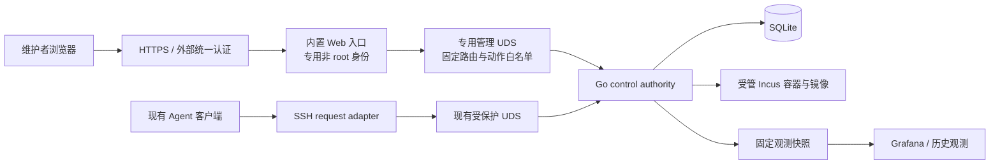

# Decision Memo：Agent VM 内置管理台

## Context

为维护者增加常驻在控制环境、随 Agent VM 产品发布的 Web 管理台。首个交付范围包括全局运维、镜像管理和已有 Agent 会话 VM 的受控管理。

用户已确认本备忘录中的整体设计基线，产品边界如下：

- 管理 Agent VM 托管资源，保留会话、租约、容量准入和操作日志规则。
- 管理台只管理已有 Agent 会话 VM，不提供管理员手动创建 VM 的入口。
- 镜像管理包括导入、适用性校验、版本与默认镜像、引用检查和安全删除。从 VM 制作镜像与自动构建镜像流水线留到后续阶段。
- 镜像导入同时支持配置过的可信 Incus 镜像源与受限本地包上传，两种来源都必须通过完整性与 Agent VM 适用性校验。
- 使用外部统一认证；Agent VM 仍负责管理员身份与操作授权。
- 管理员可以干预有效租约中的 VM，包括重启、结束租约和销毁，但须展示受影响会话、填写原因、二次确认并留下审计。
- 默认镜像切换只影响新会话。旧 VM 和缓存继续固定原镜像；换镜像需要明确销毁并重建。见 [ADR 0041](../adr/0041-agent-vm-session-pinned-image-identity.md)。

这里的 VM 是 Agent VM 产品术语，底层仍是 Incus system container，不引入 KVM、QEMU 或 `/dev/kvm`。管理台的范围不包含任意 Incus 资源、宿主机、PVE、集群、网络或存储平台管理。

本备忘录记录研究结论与推荐架构，不是实施计划，也不表示已上线任何入口。

## Evidence

### 目标仓库事实

| 事实 | 代码或合同证据 | 对方案的影响 |
| --- | --- | --- |
| 仓库没有内置 Web 应用；已有 Grafana dashboard 模板与部署侧渲染合同。 | `README.md`；`skills/agent-vm/references/observability/README.md`；`docs/specs/agent-vm/contracts/observability.md`。 | 新建产品操作面；历史时序与部署观测继续由 Grafana 承担。 |
| Gin 当前只有 control、health、固定 snapshot 三类内部路由，监听受保护 UDS。 | `skills/agent-vm-ops/control/internal/httpserver/server.go:64`、`:171`。 | 需要新增浏览器访问与认证边界，不能直接公开内部 handler。 |
| 当前 peer UID 校验依赖 Unix 连接 context，socket 和父目录权限分别为 `0600`、`0700`。 | `internal/httpserver/server.go:71`、`:175`、`:205`，路径均相对于 Go control module。 | 把现有 handler 原样挂 TCP 会失去这套认证假设。 |
| 单一 Go authority 独占 SQLite、生命周期、native worker 与 scheduler。 | `control/cmd/agent-vm-control/main.go:95`；`control/internal/lifecycle/service.go:354`。 | Web 不得建立第二个 SQLite writer 或 Incus 控制权威。 |
| 已有 acquire、renew、release、destroy、restart、resize、端口、drain、reconcile、GC 动作。 | `control/internal/protocol/protocol.go:29`。 | 复用业务规则，增加明确的人类管理员调用身份。 |
| 列表全量返回，未提供浏览器筛选/分页、完整操作历史或审计查询接口。 | `control/internal/state/store.go:503`、`:852`；`control/internal/httpserver/server.go:81`。 | 需要专门的管理查询 API，不能只包装现有 CLI 输出。 |
| 当前配置只有一组 image alias 与 fingerprint，没有受管镜像 catalog 或导入/删除 API。 | `control/internal/config/config.go:21`；`control/internal/state/store.go:24`；`control/internal/native/incus.go:15`。 | 镜像管理是新增领域能力，包含状态与恢复设计。 |
| 新建 VM 使用配置 alias，任务记录与缓存检查使用配置 fingerprint。 | `control/internal/lifecycle/service.go:792`、`:813`、`:859`。 | 需统一不可变镜像身份并校验实际创建结果，避免 alias 漂移。已核实相关 admission/readiness 链路未见身份核验，不代表线上已发生错配。 |
| 内部 summary 和 snapshot 可能包含原始错误与诊断；当前 Go summary 也未完整提供合同中的 native status/guest availability。 | `control/internal/lifecycle/service.go:1805`、`:2293`；`control/internal/observe/textfile.go:88`；`docs/specs/agent-vm/contracts/cli.md`。 | 必须增加字段白名单与有界状态采样，浏览器不可直接透传原始响应。 |
| 产品 release 有固定资产清单、校验和与回滚合同；guest images 不属于产品发布包。 | `docs/specs/agent-vm/contracts/release.md`；`skills/agent-vm-ops/scripts/build_product_release.ts`；`go-release-manifest.ts`。 | UI 和控制服务一起打包；镜像导入是独立、可审计的运行时操作。 |

表中 `control/` 均指 `skills/agent-vm-ops/control/`。本次未连接实际部署，没有核实部署入口、身份提供方、实际镜像指向或现网配置。

### Playbook 参考

读取了三个公开项目的策展快照：

- `projects/proxy-broker.md`：同一发布物内置 React/Vite/shadcn/ui 运维控制台，使用受保护入口与身份授权，覆盖 Storybook 与浏览器测试。
- `projects/xp.md`：集群管理工具将管理台与主服务一起交付，避免前后端部署版本脱节。
- `projects/codex-vibe-monitor.md`：产品控制台与 Grafana 历史观测各有边界，版本注入、实时数据与服务端契约一并验证。

选取的 Topic 为 `embedded-admin-ui`、`react-app`、`typescript-web`、`shadcn-ui`，并对照宿主仓库现有 `quality-gates`。快照和 Topic 是已有习惯的证据，不证明该项目已经采用这些前端技术。选定前端 Topic 的 Policy audit 完成且 closure 为空；`quality-gates` 的本地 package 与 lock 已验证存在。本次没有安装或更新 Policy，也没有核验 GitHub 实际分支规则。

### 官方资料核验

- [Go embed](https://pkg.go.dev/embed)：静态文件可在编译时嵌入二进制；嵌入路径必须位于所属 package/module 的合法范围内。
- [Gin 官方示例](https://github.com/gin-gonic/gin/blob/master/docs/doc.md)：支持静态资源与 `embed.FS`，可复用现有 Go/Gin 技术边界。
- [Vite production build](https://vite.dev/guide/build)：SPA 生产构建与 public base path 需要和后端静态托管一致。生产服务不依赖 Vite dev server。
- [Incus image management](https://linuxcontainers.org/incus/docs/main/howto/images_manage/)：Incus 已有镜像列表、复制/导入、alias 与删除原语；Agent VM 仍需在其上增加适用性、引用与授权规则。
- [OWASP CSRF 指南](https://cheatsheetseries.owasp.org/cheatsheets/Cross-Site_Request_Forgery_Prevention_Cheat_Sheet.html)：浏览器状态修改需要 CSRF 防护；仅有 `SameSite` 不能作为通用方案。

## Recommendation

### 交付与技术栈

推荐 `web/` 使用 React、TypeScript、Vite、shadcn/ui，并沿用 Bun 与锁文件。构建产物放入 Go module 内的生成目录，由 `go:embed` 进入产品二进制；与 Go 服务共享产品版本、安装包和回滚单元。SSR 对这个已认证操作台没有明显收益，首轮采用同源 SPA。

不新增常驻 Node/Bun Web 后端、Redis 或第二个数据库。依赖版本在实施时按现有工具链验证并锁定，本研究不使用未经验证的“最新版”要求。

### 权限与进程边界

推荐同一产品二进制提供独立的受限 `web` 进程，由专用非 root 身份运行；现有 `serve` 继续作为唯一控制权威。Web 进程只负责静态资源、外部认证适配、浏览器请求及受限管理 API 转发。



这是已确认的进程设计，见 [ADR 0042](../adr/0042-agent-vm-web-management-boundary.md)。其代价是新增专用管理 socket、systemd unit 与跨进程请求合同；收益是浏览器解析、静态资源与外部认证不进入现有高权限进程。不能直接放宽现有 root-only socket 以供 Web 使用，也不能把 Web 用户加入通用 `incus-admin` 组。

专用管理入口由 authority 检查 peer 身份、动作与作用域。Web 不得转发任意 `/internal/v1/control` body，管理员身份、原因和操作 ID 必须随允许的管理请求传入并受可信入口约束。authority 负责最终 ownership、generation、租约、资源、镜像引用和 journal 检查。

外部认证推荐先接可信反向代理的 Forward Auth，加管理员稳定身份白名单；只有部署配置明确可信代理路径时才接受身份头，并剥离浏览器自带的同名头。若实际登录体系要求服务直接作为 OIDC client，则替换认证适配层，保留同样的授权合同。未配置可信认证时拒绝启用管理入口。具体身份提供方、issuer、claim、域名和 TLS 配置属于部署输入，不能从 Playbook 推定。

### 页面与功能

| 页面 | 首个交付范围 | 主要规则 |
| --- | --- | --- |
| 概览 | 容量、准入、排空、CPU PSI、磁盘余量、任务计数与各来源更新时间。 | `null`/未验证/过期不能显示为零或健康；压力与逻辑剩余分开。 |
| VM | 状态筛选、分页、会话/实例/镜像身份、资源、租约、端口、结构化故障；详情及管理员操作。 | 不提供手动创建。显示 ownership、generation 与有效租约；并发更新按冲突处理。 |
| 镜像 | 导入、校验、不可变版本、默认选择、活跃/缓存/待创建引用、退役与删除。 | 只有校验通过的镜像可设默认；默认切换不改变旧会话绑定。 |
| 操作与审计 | 镜像任务与 VM 操作的状态、阶段、结果、管理员、原因、目标与时间。 | 操作 ID 可追踪；HTTP 断开不等于操作取消或失败。 |
| 系统 | 产品版本、组件健康、排空、reconcile/GC 预览与明确执行。 | 不提供 shell、任意命令、宿主机管理或自动部署入口。 |

VM 动作沿用产品语义：重启、扩容、释放租约并停止、销毁和必要的端口维护。释放会撤销访问并保留合格缓存，不能用一个含糊的“关机”按钮代替。暂停、独立 start/stop、快照、克隆、迁移、Web terminal 与自动换镜像不纳入当前范围；需要时另行明确会话、访问和租约语义。

有效租约中的干预必须呈现受影响会话、操作后果与当前 generation。管理员提交原因并确认后，后端重新校验状态；租约自然过期、Agent 同时 release/resize、或后台回收都可能导致操作冲突，不能依赖前端按钮可用性决定授权。

## 镜像领域与异步操作

### 最小模型

- `ManagedImage`：不可变内容 fingerprint、架构、实例类型、来源、导入状态、适用性结果与有界说明。只接受适用于 system container 的镜像。
- `ImageSelection`：默认镜像与显示标签。标签是可变指针，不代替不可变身份。
- `SessionImageBinding`：会话/VM 固定的内容身份。活跃 VM、缓存与进行中的创建操作都构成引用。
- `AdminOperation`：导入、验证、删除和人工干预的持久执行记录。须与现有 operation journal 明确分工，避免第二套生命周期权威。

这些对象是建议的数据职责，不代表已确定 SQL 表名。新 catalog 与管理员审计需要增量 schema/迁移与回滚兼容设计，不能为了 Web 重建当前状态库。

### 推荐流程

```text
导入请求
  校验管理员与来源/大小/架构
  持久记录操作身份与有界 staging 预留
  导入到受管项目，解析不可变 fingerprint
  核对来源完整性、容器类型和必需工具
  在受限临时容器验证 Agent VM 适用性
  标记可用或失败，清理临时资源并保留结构化结果

创建新会话
  在 authority 内原子解析默认镜像并建立引用
  按 fingerprint 初始化，核验实际基础镜像身份
  继续现有 generation、准入、租约和 journal 流程

删除镜像
  事务检查默认、活跃 VM、缓存和进行中创建的引用
  标记删除状态，阻止并发新增引用
  执行受限 native 删除
  记录终态；不确定 native 结果进入恢复流程
```

镜像文件校验与“适用于 Agent VM”是两件事：后者还需验证 Bun、源同步、锁、Git/rsync 等已声明前提及 guest readiness。不能为了校验而让不可信镜像接触生产凭据、网络或任意挂载。

导入同时支持部署配置中允许的 Incus remote 与受大小限制的镜像包上传。来源标识不能变成任意服务器 URL、文件路径或 shell 参数；上传与下载都要计入 CT root/image staging 的物理磁盘预算，不能只看 Incus pool 余量。两种来源必须复用同一完整性、适用性与引用管理流程。

导入、校验和删除应为可恢复异步操作，返回操作身份供 UI 查询。浏览器刷新、连接断开、代理超时、进程重启与重复提交必须保持同一操作语义；已有成功/失败结果可查询，native 结果不明不能自动重做。用户可见失败应为结构化 code/phase，不返回原始命令、凭据或部署路径。

## 模块边界与文件布局

建议布局：

```text
web/
├── src/features/          # overview, vms, images, operations, system
├── src/components/ui/     # checked-in shadcn/ui component layer
├── src/lib/api/           # 管理 DTO、错误和操作查询
└── .storybook/            # 核心表格、确认框、状态与错误
skills/agent-vm-ops/control/
├── cmd/agent-vm-control/  # 增加受限 web 子命令
└── internal/
    ├── webadmin/          # 浏览器入口、认证适配、静态资源
    ├── adminapi/          # 管理 UDS、权限与安全 DTO
    ├── images/            # catalog、引用、验证与镜像任务
    ├── webassets/         # module 内生成资源与 embed.FS
    ├── lifecycle/         # 唯一生命周期与准入规则
    └── state/             # 现有 SQLite 与增量持久状态
```

未来代码改动还会涉及 root scripts/lock、生成目录忽略规则、管理入口与镜像配置 schema、native 固定操作、systemd 资产、产品 release allowlist/wrapper、现有 Spec/CLI/观测合同及 CI。这里仅列出预期范围，不授权部署或远端写入。

## Alternatives

| 方案 | 优点 | 代价与适用条件 |
| --- | --- | --- |
| 推荐：随产品交付的 SPA + 独立受限 Go Web 进程。 | 同版本发布、保持单一控制权威、隔离浏览器处理与 root native 执行。 | 增加专用 UDS 与 unit；适合当前高权限控制服务。 |
| 在现有 authority 进程内增加独立的管理 listener/router。 | 进程少，直接调用 service，无新增内部 RPC。 | Web/auth 的攻击面进入高权限进程；必须完整重做认证与路由隔离，不能把现有 handler 暴露到 TCP。 |
| 独立部署 Web/BFF，或使用通用 Incus UI。 | 可单独演进；通用 UI 可以减少通用资源管理的界面工作。 | 独立部署增加版本与运维负担；直接操作 Incus 无法承担 Agent VM 的会话、租约、generation、容量准入与 journal 合同，不符合已确认的产品范围。 |

本机临时 Web + SSH 桥接已在产品决策中排除，目标为常驻内置控制台。Grafana 保留历史观测职责；它的只读指标模型不能承载镜像导入和 VM 生命周期管理。

## 验证与交付影响

实施需复用当前 `bun run check`、两个 Bun test scope 与 Go tests/vet，增加对应契约验证：

- 管理入口的 peer 身份、外部身份伪造拒绝、管理员白名单、CSRF/Origin、固定动作与 DTO 脱敏；未配置认证拒绝开放。
- 镜像 fingerprint/alias 一致性、适用性、默认切换与会话固定、引用删除竞态、磁盘不足、超时、中断恢复和重复提交。
- 管理员与 Agent/expiry/reconcile 并发时的 generation、租约、幂等与 ownership；不能绕过 pending journal。
- UI typecheck/build、组件状态与 Storybook/a11y、浏览器流程及受控视觉证据；桌面与移动端的表格、详情、确认与过期状态。
- 真正的产品包静态资源、SPA deep link、API 404、cache/version、双架构构建、unit 权限与完整包回滚。

重型浏览器/集成、Go race、native process-tree、isolated Incus/systemd 和真实镜像导入校验放在会话独占 Agent VM 内，使用隔离受管资源。它们不授权生产环境操作。

现有 required checks 为 `PR gate (ubuntu-latest)`、`PR gate (macos-latest)`；优先把 Web 验证接入这些稳定 job，Linux 专属验收按平台分工。Playbook 的 React Doctor 使用锁定工具与配置，本地针对 staged、CI 针对 changed React 文件，诊断 error 阻断、warning 可见；无法计算范围时失败，确认空集合时跳过。root 当前 tsconfig 仅包含 `bin/**` 与 `skills/**`，因此必须显式纳入 Web typecheck，不能假定原有命令已经覆盖。

required check 名称保持时仍需审查 `.github/quality-gates.json` 的声明语义；如新增独立 required job，必须同步声明并在获得交付授权后核验平台规则。保留现有 signed-commit、PR-only main 与显式 waiver 规则。研究阶段没有修改工作流、分支保护、release 策略或安装包。

## Follow-ups

产品事实已集中到 [PRODUCT.md](../../PRODUCT.md)，视觉方向与实施基线保存在 [DESIGN.md](../../DESIGN.md)，页面任务与构建约束保存在 [Web 界面简报](../../.impeccable/surfaces/web.md)。用户选定“检修工作台：清单与受控操作并列”方向；具体视觉参数尚未从已实现界面验证。

已确认的技术基线为 React/Vite/shadcn/ui、同产品版本内嵌静态资源、独立受限 Web 进程与专用管理 UDS。数据更新先以有界轮询消费快照和操作状态；现有快照各自独立刷新，保留来源健康与时间戳，不让浏览器轮询触发 native 采样。

管理 API、Forward Auth、隔离验证、图像引用、持久操作与状态能力回退规则见 [管理台合同](../specs/agent-vm/contracts/management-api.md) 和 [OpenAPI](../specs/agent-vm/contracts/management-api.yaml)。具体代理 UID、外部 Origin、管理员主体、允许来源、上传限额和 staging 余量仍是受保护配置中的部署输入。

产品选择与整体架构已由用户确认。该备忘录记录研究与架构依据；新增管理行为以 Agent VM Spec 和管理台合同为准。文档本身不证明功能已实现，也不授权真实身份提供方接入、生产镜像操作或现网部署。
