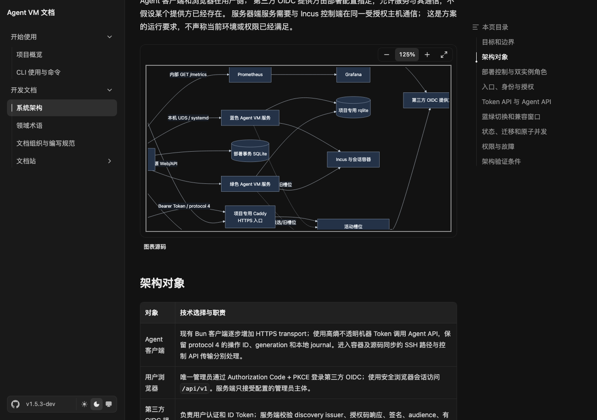
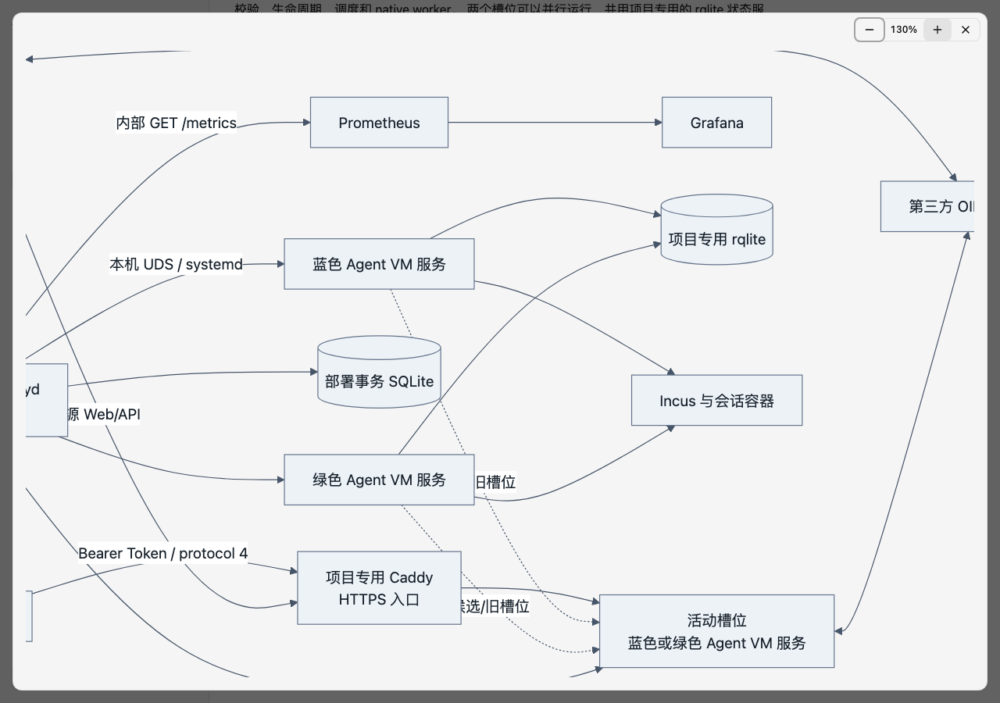
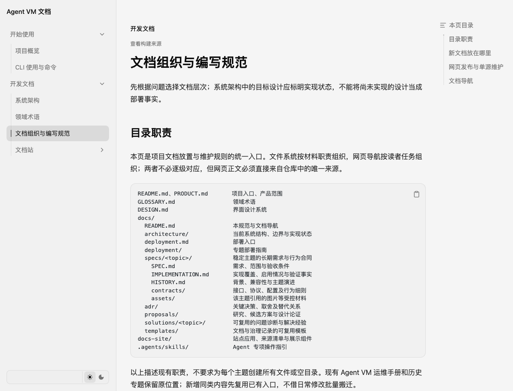

# Agent VM 最小独立文档站

> 长期需求与验收合同。实现事实见 [IMPLEMENTATION.md](IMPLEMENTATION.md)，背景见 [HISTORY.md](HISTORY.md)。

## Context and Scope

文档站用于展示文档，让用户理解如何使用项目，让开发者理解项目如何设计。文档是核心对象，阅读、理解与定位是核心行为；方便人类审查设计通过清晰的正文表达实现。

先完成设计文档，再建立独立 Fumadocs 站点。站点以 Agent VM 项目及读者任务组织信息；最小内容集包括已有的项目概览、CLI、系统架构、术语及文档站主题材料。管理台嵌入、完整项目文档迁移以及生产和 Demo 接入属于后续工作。

独立审阅工作台、需求追溯界面、关联异常演示及为它们新增的作者维护要求不属于本阶段。未来的文档审阅功能若需要建设，应围绕具体文档、版本、段落及反馈另行设计。

## Terms and Interfaces

- Markdown 或 MDX 是正文唯一可编辑来源，生成输入、HTML 与来源快照不作为另一份手工维护正文。
- MDX 用于正文中确有必要的交互表达，不用于建设需求管理界面。
- 产品随附文档与上下文帮助见 [GLOSSARY.md](../../../GLOSSARY.md)。

## Requirements

### REQ-DOCS-001 — 首期内容与入口

首页和导航必须围绕 Agent VM 项目提供“开始使用”与“开发文档”入口。最小集复用已有项目概览、CLI 和系统架构，文档站自身的需求、方案、内容来源与实现说明放在开发文档下的“文档站”主题。不得把“本次设计”或“来源材料”作为站点主导航，不得以占位文章代替真实内容，也不要求先迁移全部项目文档。

开发文档必须提供文档组织与编写规范入口，统一说明目录职责、新文档放置、设计材料沉淀和网页发布规则。正文以 `docs/README.md` 为唯一来源；AGENTS.md 和项目 Skill 引用该规范，新增目录职责时同步维护。

### REQ-DOCS-002 — 单一内容来源

已有 Markdown 保持原始路径；富交互正文可以使用 MDX。站点自动适配标题元数据、链接、资源与图表，不要求维护同义正文副本，也不要求作者增加 design-id、需求到设计的 covers 或 trace-note 等站点专用关联声明。既有 Spec 需求编号和验收 covers 继续作为原始文档内容展示，不驱动独立追溯功能。

原文标题变更应同步呈现；阅读验证使用当前原文作为依据，不维护另一份必须手工同步的正文标题。

### REQ-DOCS-003 — 独立工程

文档站以独立子项目维护，使用已选定的 Fumadocs，独立构建和预览，不依赖管理台、管理 API 或 Go 服务。首期采用 Bun workspace、Vite 与 React Router 静态预渲染；正文与站点外壳保持清晰边界，供后续复用。Vite 是工程偏好，不是用户功能。

### REQ-DOCS-004 — 阅读、表达与定位

站点提供导航、页内目录、明暗主题、页面与章节链接，以及可读的中文正文、表格、代码和必要图表。外壳与导航复用 Fumadocs UI 的标准布局及页面树；分组使用一致的目录控件、层级缩进和当前页标记，当前页的祖先目录自动展开，窄屏通过框架抽屉访问目录。按内容实际需要采用方案对比、可展开说明或交互示例，增强理解；不为了体现 Web 能力人为增加工作台或业务模拟器。相对链接、显式锚点、资源和必要源码引用应指向对应内容。桌面、中间宽度、窄屏和键盘访问均能完成阅读及定位。

界面优先使用已选 UI 库的完整布局、组件和公开样式原语，覆盖正文布局、响应式页内目录、折叠、代码复制、提示和按钮；手工实现限于库能力缺口，并记录理由。

图表文字必须支持直接选择和复制，选区在明暗主题下均清楚可见。默认完整展示图表，支持正文内缩放、平移、复位及大视图；鼠标、触控和键盘均可操作，文字选择不被拖动吞掉。大视图关闭后返回触发按钮并保留正文视图状态。侧栏提供固定项目 GitHub 入口和来自构建版本的标识；主题支持浅色、深色、跟随系统，并保留用户选择。

### REQ-DOCS-007 — 来源身份与复现

使用指定源码、锁定依赖和配置可重新生成独立静态站点。预览可以查看来源提交、修改状态和输入摘要，版本标识由 Git 版本标签派生，区分正式标签上的干净构建、开发提交和本地修改，无标签时不得伪造产品版本，相关构建信息作为辅助内容而不占据正文主入口。提供实际正文快照与行定位，修改中的内容不得冒充干净远端提交。单篇正文语法错误保留来源与明确错误提示，严格检查拒绝失效引用及正文解析错误。依赖或工具链整体失败应正常报告构建失败。

指向修改中来源的章节链接应定位该快照中的实际行，支持中文及显式锚点；缺失锚点进入引用诊断。正文错误隔离仅处理可识别的语法或元数据错误，其他编译异常继续向构建流程抛出。

### REQ-DOCS-008 — 验证与效率

验证真实 Markdown／MDX、图表、链接、来源身份和独立构建。记录冷构建、单文档开发重编译及完整预渲染耗时，说明环境与输入，不预设性能阈值。文档开发不要求重建 Go。

负责人使用真实设计材料检查内容是否完整、是否易读、能否通过目录和链接理解并定位设计；图表或交互应帮助理解具体内容。自动测试与构建成功不代替这一使用确认，不再以需求追溯路径或缺少关联案例作为人工验收条件。

### REQ-DOCS-009 — 后续边界

首期不包含管理台帮助按钮、popover、共享包、Go 资源打包、完整项目文档迁移、生产或 Demo 嵌入、公开托管、在线批注及发布部署。需求确认不授权真实管理操作或现网变更。

## Verification

### VER-DOCS-001 — 内容与单源

- covers: `REQ-DOCS-001`, `REQ-DOCS-002`
- 方法：核对来源清单，修改唯一正文并重建，比较网页与来源快照。
- 通过条件：首页引导使用和开发任务，文档站主题层级清楚，真实材料完整，无同义副本及额外关联维护要求。

### VER-DOCS-002 — 独立阅读与表现

- covers: `REQ-DOCS-003`, `REQ-DOCS-004`
- 方法：独立构建，检查中文、目录、代码、表格、Mermaid、章节链接、来源入口及键盘；覆盖桌面、1024px 和 393×852 窄屏。
- 通过条件：材料可读且可定位，正文流自然，页面不横向溢出，必要图表有效；没有独立审阅页或追溯功能。

### VER-DOCS-004 — 身份与错误处理

- covers: `REQ-DOCS-007`
- 方法：测试干净、修改及未跟踪来源，摘要、固定提交链接、修改来源快照、语法错误与冻结锁文件重建。
- 通过条件：来源身份准确，单篇错误明确且来源可查，严格检查拒绝坏引用及解析错误。

### VER-DOCS-005 — 阅读价值与效率

- covers: `REQ-DOCS-008`
- 方法：测量构建及重编译；负责人从项目首页进入使用指南、系统架构和文档站设计，通过目录和正文引用定位相关段落，检查图表是否帮助理解。
- 通过条件：性能有环境绑定证据，开发不重建 Go，负责人确认文档阅读和表达符合预期。

### VER-DOCS-006 — 范围

- covers: `REQ-DOCS-009`
- 方法：检查工程、路由、依赖与交付副作用。
- 通过条件：未引入后续嵌入、审阅工作台、公开托管或现网操作。

## Related ADRs

None

## References

- [范围说明](../../proposals/agent-vm-documentation-review.md)
- [内容适配](../../proposals/agent-vm-documentation-source.md)
- [工程方案](../../proposals/agent-vm-documentation-stack.md)

## Visual Evidence

负责人分别接受文档阅读与图表呈现，以及新增的文档组织规范入口。以下为对应的受控静态页面证据。

