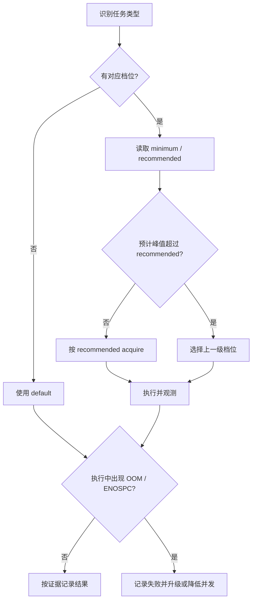

# Agent VM 资源选择指南

本指南为常见任务提供初始资源建议，帮助在容量有限时选择足够而不过度的 Agent VM。建议值是 advisory starting points，不改变控制服务的 admission、reservation、Incus 配置或默认申请行为。

## 快速选择

| 任务 | 档位 | CPU | 内存 | 磁盘 | 适用说明 |
| --- | --- | ---: | ---: | ---: | --- |
| 轻量脚本和小型检查 | `default` | 2 | 4 GiB | 20 GiB | 默认值，适合短时单进程任务 |
| 普通项目测试 | `standard` | 4 | 8 GiB | 30 GiB | Go、TypeScript 或小型 Rust 项目 |
| Rust workspace 构建 | `rust-build` | 8 | 12 GiB | 40 GiB | 依赖较多或链接阶段有峰值 |
| 大型 Rust 构建 | `heavy-rust` | 12 | 24 GiB | 80 GiB | 大型 workspace、调试符号或重型链接 |
| 多服务集成验证 | `integration` | 8 | 16 GiB | 60 GiB | Docker/Compose、数据库、浏览器和缓存 |

`default` 保持为 2 vCPU、4 GiB RAM 和 20 GiB 磁盘。无法判断任务类型时使用 `default`，首次出现 OOM、ENOSPC 或明显等待后，按 `default → standard → rust-build → heavy-rust` 升级；需要多个后台服务时改用 `integration`。

## 申请和调整

先设置稳定的 session identity，再申请明确规格；省略资源参数会复用停止缓存的规格或使用默认值。

```bash
export AGENT_VM_SESSION_ID=resource-guide-example
bun "<skill-dir>/scripts/agent_vm.ts" acquire --cpu 8 --memory 12GiB --disk 40GiB
```

活动 lease 的规格变化必须显式调整。CPU、磁盘或需要重启的内存调整先确认中断当前进程可接受，再使用 `--allow-restart`；只降低或调整内存且希望保留 guest 连续性时使用 `--live`。

```bash
bun "<skill-dir>/scripts/agent_vm.ts" resize --memory 16GiB --allow-restart
bun "<skill-dir>/scripts/agent_vm.ts" resize --memory 8GiB --live
```

`resize --live` 只接受 `--memory`，不会替 CPU 或磁盘调整自动选择重启路径。调整前后都应检查 `status`，确认 `effective_lease` 和 `guest_available`，不要把共享 CT 计数器的变化直接解释为 guest OOM。

## Rust 构建

4 GiB 只适合小型 crate 和低并发检查；workspace 构建或链接阶段有峰值时从 `rust-build` 起步。`CARGO_BUILD_JOBS` 可以限制同时运行的 rustc 进程并降低峰值，但不能替代足够的内存；CPU、构建并发和内存应一起调整。

```bash
cd /workspace/project
CARGO_BUILD_JOBS=4 cargo build --workspace --all-targets
```

构建仍然 OOM 时，先确认 `memory.events` 中的 `oom` 或 `oom_kill`，再升级到 `heavy-rust` 或降低 `CARGO_BUILD_JOBS`。不要只增加 CPU：更高的并行度可能同时提高内存峰值。

## 磁盘和缓存

磁盘建议必须覆盖源码、`target/`、Cargo registry、Docker 镜像和测试产物，并至少保留 30% 的空闲空间。构建过程中出现 ENOSPC 时，先检查 `df -h` 和最大的缓存目录，再扩大磁盘或清理当前项目可重建的缓存；不要删除不属于当前 session 的路径。

```bash
df -h /
du -sh /workspace/* /root/.cargo 2>/dev/null || true
```

## SWAP 和运行时证据

当前 Agent VM 生命周期只配置 CPU、内存和磁盘；Agent VM 不会创建 swapfile，也不保证容器级 SWAP 已启用。每个档位的 `swap` 都是 `host-dependent`，实际状态必须以 guest 和控制环境的运行时查询为准。SWAP 可以缓冲短时压力，但不能作为 Rust 构建主要内存的替代品；持续 swap thrashing 应升级内存、降低并发或终止不需要的后台服务。

```bash
free -h
swapon --show
cat /sys/fs/cgroup/memory.current
cat /sys/fs/cgroup/memory.peak
cat /sys/fs/cgroup/memory.events
cat /sys/fs/cgroup/memory.swap.max
```

`memory.swap.max` 可能返回 `max`、数值或因运行环境不可见而失败；失败本身应记录为观测缺失，不应推断 SWAP 已启用或已禁用。

## 失败升级

| 现象 | 先收集 | 下一步 |
| --- | --- | --- |
| Rust OOM 或 `oom_kill` 增长 | `memory.current`、`memory.peak`、`memory.events`、构建并发 | 降低 `CARGO_BUILD_JOBS`，仍不足则升级内存档位 |
| 构建过程 ENOSPC | `df -h`、`du -sh`、缓存目录 | 清理可重建缓存或扩大磁盘档位 |
| SWAP 持续高占用或 thrashing | `swapon --show`、`memory.swap.max`、构建耗时 | 降低并发并升级内存；不要把 SWAP 当作容量承诺 |
| 任务结束后资源长期闲置 | `status`、后台进程、缓存用途 | 保留缓存需要时 live 降容，否则按 Finish 规则 release |

每次新项目或异常构建都应按 [资源校准记录](resource-evidence.md) 留下证据。连续三次成功且峰值低于当前推荐值的 70% 后，才考虑下调建议；一次 OOM、ENOSPC 或明显 swap thrashing 都必须保留失败记录。

## 资源选择流程


